# Kampung Adem: Dokumen Perancangan Sistem End-to-End

Peta Panas Real-Time Tingkat Kampung Berbasis Sensor Murah dan Citra Satelit untuk Peringatan Dini Panas Ekstrem di Surabaya

Nov 2, 2026 · @Andra · Kelompok 6, MK4056 Perubahan Iklim ITB

## 1. Executive Summary

Kampung Adem dapat dibangun dengan anggaran hardware sekitar **Rp16,4 juta untuk prototype 5 node**, **Rp46,6 juta untuk pilot 20 node**, dan **Rp118,2 juta untuk implementasi awal 50 node**, dengan biaya operasional bulanan mulai sekitar Rp300 ribu. Semua angka sudah termasuk cadangan kerusakan 10-15% dan dihitung dari harga marketplace Indonesia yang dicek pada 2 November 2026 (rincian di Bagian 6 dan 17).

Sistem ini memasang sensor suhu dan kelembapan udara murah di setiap RW, mengirim datanya lewat LoRaWAN ke server, menggabungkannya dengan peta suhu permukaan (LST) dari satelit Landsat 8/9, lalu mengirim peringatan WhatsApp resmi ke RT/RW dan kader posyandu saat indeks panas melewati ambang.

**Keputusan desain utama (usulan final):**

| Layer | Pilihan | Alasan singkat |
| --- | --- | --- |
| Sensor | Sensirion SHT31 (modul GY-SHT31-D) | Akurasi tipikal ±0,2 °C dan ±2 %RH, harga modul sekitar Rp62 ribu |
| Node | Heltec WiFi LoRa 32 V3 (ESP32-S3 + SX1262) | MCU dan radio LoRa dalam satu papan, ada konektor baterai dan charger |
| Jaringan | LoRaWAN band AS923-2 (920-923 MHz) | Sesuai pita LPWA Indonesia, satu gateway melayani banyak node |
| Gateway | Dragino LPS8N (prototype dan pilot) | Gateway 8 kanal termurah yang ditemukan di Tokopedia, Rp4,75 juta |
| Backend | Python FastAPI + worker terjadwal | Ekosistem Python kuat untuk data sensor, raster satelit, dan interpolasi |
| Database | PostgreSQL + PostGIS + TimescaleDB | Satu mesin untuk data relasional, spasial, dan time-series |
| Frontend | React + Vite + Leaflet | Dashboard di balik login, peta gratis berbasis OpenStreetMap |
| Satelit | Landsat 8/9 Collection 2 Level-2 lewat Google Earth Engine | Resolusi 30 m (thermal asli 100 m), revisit gabungan 8 hari |
| WhatsApp | WhatsApp Cloud API resmi dari Meta, template kategori utility | Resmi, tanpa biaya platform bulanan, bayar per pesan |
| Hosting | VPS lokal Indonesia (mis. IDCloudHost), Docker Compose | Murah, data tersimpan di Indonesia |

**Tiga hal yang perlu dipahami semua pihak:**

1. **"Real-time" hanya berlaku untuk data sensor** (diperbarui tiap 10-15 menit). Data satelit adalah lapisan latar yang diperbarui tiap 8-16 hari dan hanya saat langit cerah.
2. **Suhu udara (sensor) dan suhu permukaan (LST satelit) adalah dua variabel berbeda.** Sistem memakai LST untuk menunjukkan di mana permukaan paling panas, dan memakai sensor untuk mengukur panas udara yang dirasakan warga.
3. **Status peringatan adalah ambang operasional, bukan diagnosis medis.** Sistem tidak pernah menyatakan seseorang terkena heatstroke. Ambang awal memakai kategori heat index NOAA dan wajib dikalibrasi bersama Dinas Kesehatan dan BMKG Juanda selama pilot.

**Cara membaca dokumen ini:** setiap klaim diberi label **\[Fakta\]** (bersumber, tautan di Bagian 21), **\[Asumsi\]** (perkiraan tim yang perlu diverifikasi), atau **\[Usulan\]** (rekomendasi desain yang belum diputuskan).

## 2. Latar Belakang dan Kebutuhan Sistem

Sistem dibutuhkan karena informasi panas yang tersedia saat ini berskala kota, sedangkan risiko panas dirasakan per gang dan per RW.

**Masalah yang dijawab:**

- Peta UHI dan peringatan cuaca BMKG umumnya berskala kota atau kecamatan. Kondisi antar-RW bisa berbeda karena kepadatan bangunan, atap seng, minimnya pohon, dan lebar gang. **\[Fakta, dari konsep proyek\]**
- BMKG berulang kali menegaskan bahwa udara panas di Indonesia umumnya **bukan gelombang panas (heatwave)** secara definisi statistik, melainkan siklus tahunan akibat gerak semu matahari ([Kontan/Kompas](https://nasional.kontan.co.id/news/bukan-karena-gelombang-panas-ini-analisis-bmkg-soal-fenomena-udara-panas-di-ri)). Artinya, sistem tidak boleh memakai istilah "gelombang panas" sembarangan. Istilah yang dipakai: **"panas ekstrem tingkat lingkungan"**. **\[Fakta\]**
- Kombinasi suhu dan kelembapan menentukan beban panas tubuh. Contoh yang dikutip media: suhu tengah hari 32 °C dengan kelembapan 70% menghasilkan heat index sekitar 41 °C ([NU Online](https://www.nu.or.id/nasional/bukan-gelombang-panas-ini-durasi-dan-penyebab-suhu-panas-di-indonesia-5IvTg)). Karena itu sistem wajib mengukur kelembapan, bukan hanya suhu. **\[Fakta\]**
- Kelompok rentan (lansia, balita, ibu hamil, pekerja luar ruang) sudah terpetakan oleh kader posyandu dan RT/RW, tetapi mereka belum punya pemicu informasi yang lokal dan tepat waktu. **\[Fakta, dari konsep proyek\]**

**Kebutuhan fungsional:**

| Kode | Kebutuhan | Prioritas |
| --- | --- | --- |
| F1 | Mengukur suhu udara dan kelembapan relatif di 2-5 titik per RW, interval 5 menit | Wajib |
| F2 | Mengirim data tanpa Wi-Fi di setiap titik (LoRa) | Wajib |
| F3 | Menyimpan riwayat pengukuran minimal 2 tahun | Wajib |
| F4 | Menghitung heat index dan status per RW | Wajib |
| F5 | Menampilkan peta panas per RW dan lokasi sensor | Wajib |
| F6 | Mengirim WhatsApp ke penerima sesuai wilayah saat status naik | Wajib |
| F7 | Menampilkan lapisan LST satelit sebagai konteks | Wajib |
| F8 | Memantau kesehatan perangkat (baterai, sinyal, data terakhir) | Wajib |
| F9 | Laporan bulanan untuk kelurahan dan Dinkes | Sebaiknya |
| F10 | Halaman publik ringkas tanpa login | Opsional |

**Kebutuhan non-fungsional:**

| Aspek | Target **\[Usulan\]** |
| --- | --- |
| Latensi data sensor sampai dashboard | kurang dari 2 menit setelah paket diterima gateway |
| Latensi peringatan WhatsApp | kurang dari 5 menit setelah status terkonfirmasi |
| Kelengkapan data | minimal 90% paket per node per hari diterima |
| Ketahanan node | baterai dan panel surya, tanpa listrik PLN di titik sensor |
| Ketahanan offline | node menyimpan bacaan saat gagal kirim, server menyimpan antrian WA saat API gagal |
| Privasi | nomor WhatsApp penerima terenkripsi, akses berbasis peran |
| Biaya | biaya tunai sekitar Rp320 ribu/bulan saat prototype dan di bawah Rp1 juta/bulan saat pilot (Bagian 17) |

## 3. Gambaran Umum Solusi

Kampung Adem bekerja dalam empat langkah: **ukur, kirim, olah, peringatkan**. Konsep utama dari dokumen judul tidak diubah; bagian ini hanya menerjemahkannya menjadi komponen teknis.

1. **Ukur.** Sensor node bertenaga surya di tiang atau dinding (tinggi 1,5-2 m) membaca suhu udara dan kelembapan tiap 5 menit di dalam pelindung radiasi.
2. **Kirim.** Node mengirim paket kecil (12 byte) lewat LoRaWAN ke gateway di balai RW atau kantor kelurahan. Gateway meneruskan lewat internet ke network server lalu ke backend.
3. **Olah.** Backend memvalidasi data, menghitung heat index, menggabungkan dengan LST satelit per RW, lalu menentukan status tiap RW.
4. **Peringatkan.** Jika status naik dan bertahan, sistem mengirim template WhatsApp ke penerima yang terdaftar untuk RW tersebut. Dashboard menampilkan peta, grafik, dan riwayat.

**Apa yang baru dibanding kondisi sekarang:**

| Aspek | Kondisi sekarang | Kampung Adem |
| --- | --- | --- |
| Skala informasi | Kota/kecamatan | RW |
| Sumber data | Stasiun BMKG (Juanda, Perak) dan model | Sensor lokal + LST satelit + data BMKG sebagai pembanding |
| Saluran ke warga | Media, aplikasi Info BMKG | WhatsApp langsung ke RT/RW dan kader |
| Pelaku tindak lanjut | Umum | Struktur RT/RW dan posyandu yang sudah ada |

**Batas lingkup \[Usulan\]:**

- Tidak membuat aplikasi mobile untuk warga pada tahap awal. WhatsApp sudah dipakai semua penerima.
- Tidak membuat model prediksi (forecast) pada tahap prototype. Prakiraan BMKG dapat ditampilkan sebagai konteks pada tahap pilot jika data tersedia.
- Tidak menyatakan diagnosis kesehatan. Tindakan medis tetap mengikuti arahan puskesmas dan Dinkes.

## 4. System Architecture

Data mengalir satu arah dari lapangan ke cloud, lalu keluar lagi ke pengguna lewat dua kanal: dashboard web dan WhatsApp.

### 4.1 Diagram arsitektur end-to-end

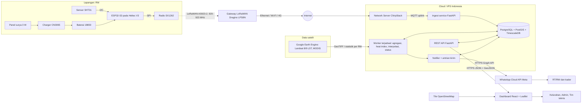

### 4.2 Penjelasan komponen dan hubungannya

| Komponen | Fungsi | Terhubung ke | Protokol / format |
| --- | --- | --- | --- |
| Sensor SHT31 | Mengukur suhu udara dan RH | Microcontroller | I2C, alamat 0x44 |
| Microcontroller ESP32-S3 | Membaca sensor, merata-rata, mengemas payload, mengatur tidur | Sensor dan radio | I2C, SPI |
| Radio LoRa SX1262 | Memancarkan paket ke gateway | Gateway | LoRaWAN Class A, OTAA |
| Gateway LoRaWAN | Menerima semua paket di sekitarnya, meneruskan ke network server | Internet | Semtech UDP atau Basics Station / MQTT |
| Internet | Jalur backhaul gateway | Network server | Ethernet/Wi-Fi mitra, cadangan modem 4G |
| Network server (ChirpStack) | Autentikasi perangkat, dekripsi, deduplikasi, ADR | Ingest service | MQTT (JSON) |
| Ingest service | Decode payload, simpan ke database | Database | SQL |
| Database | Menyimpan data relasional, spasial, dan time-series | Semua layanan backend | PostgreSQL |
| Worker | Agregasi, heat index, interpolasi, status, tarik data satelit | Database, GEE, Notifier | Python, cron internal |
| Data satelit (GEE) | Menyediakan LST Landsat 8/9 dan MODIS | Worker | Earth Engine Python API |
| REST API | Melayani dashboard dan integrasi luar | Dashboard | HTTPS, JSON, GeoJSON |
| Dashboard | Peta, grafik, manajemen | Pengguna | Browser |
| Notifier | Memilih penerima, mengirim WA, mencatat status | WhatsApp Cloud API | HTTPS Graph API, webhook |
| Pengguna akhir | Membaca dashboard dan menerima WA | Dashboard, WhatsApp | Browser, aplikasi WhatsApp |

**Ketergantungan penting:** dashboard tetap jalan walaupun satelit atau WhatsApp gagal, karena keduanya hanya membaca/menulis ke database. Jika internet gateway putus, node tetap menyimpan bacaan di memori dan mengirim ulang ringkasan saat jaringan pulih (Bagian 5.3).

### 4.3 Deployment architecture

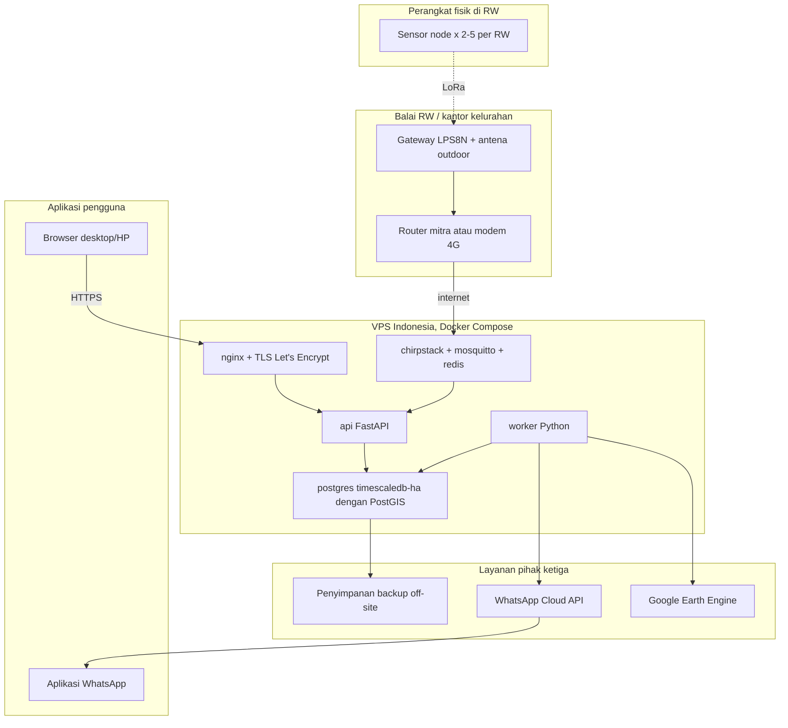

| Lokasi | Yang berjalan | Catatan |
| --- | --- | --- |
| Titik sensor | Firmware node (Arduino/PlatformIO + RadioLib atau LMIC) | Tanpa listrik PLN |
| Balai RW/kelurahan | Gateway, router/modem | Butuh listrik PLN 5 V/12 V dan internet |
| VPS | Semua container backend dalam satu server | Satu server cukup sampai implementasi awal (Bagian 16) |
| Pihak ketiga | WhatsApp, GEE, backup | Akun atas nama tim atau mitra pemerintah |
| Pengguna | Browser dan WhatsApp | Tidak perlu instal aplikasi baru |

## 5. Hardware Design

Satu sensor node terdiri dari papan Heltec WiFi LoRa 32 V3, sensor SHT31, baterai 18650, panel surya 3 W, charger CN3065, kotak ABS, dan pelindung radiasi, dengan biaya sekitar **Rp1,22 juta per node** (harga dicek 2 November 2026).

### 5.1 Perbandingan alternatif komponen

**Sensor suhu dan kelembapan**

| Sensor | Akurasi suhu | Akurasi RH | Harga modul (Indonesia) | Catatan | Keputusan |
| --- | --- | --- | --- | --- | --- |
| **SHT31** (Sensirion) | ±0,2 °C tipikal pada 0-90 °C | ±2 %RH | Rp50.000-62.000 ([isee](https://www.tokopedia.com/isee/sht31-d-temperature-humidity-sensor-breakout-weather-for-arduino-i2c-p), [akhishop](https://www.tokopedia.com/akhishop/sht31-d-temperature-humidity-sensor-module)) | I2C, kalibrasi pabrik, drift rendah | **Dipilih** |
| SHT35 | ±0,1 °C pada 20-60 °C | ±1,5 %RH | Belum ditemukan listing Indonesia yang terverifikasi | Pin dan library sama dengan SHT31 | Opsi upgrade |
| SHT31 probe tahan cuaca | ±0,2 °C | ±2 %RH | Rp485.000 ([alfaelectro](https://www.tokopedia.com/alfaelectro/sht31-outdoor-temperature-humidity-sensor-40-125-i2c)) | Sudah ber-housing, kabel 1 m | Opsi pilot jika anggaran ada |
| BME280 | Lebih rendah dari SHT3x **\[Perlu verifikasi datasheet Bosch\]** | Lebih rendah | Rp395.000 versi Grove ([warehouseelectronic](https://www.tokopedia.com/warehouseelectronic/etalase/3-sensor-temperature-humidity)) | Ada tekanan udara, rawan self-heating | Tidak dipilih |
| DHT22 | Lebih rendah dari SHT3x **\[Perlu verifikasi\]** | Lebih rendah | Rp35.000 ([starlectric](https://www.tokopedia.com/starlectric/dht22-modul-sensor-suhu-kelembapan-kabel)) | Protokol 1-wire, kualitas antar-batch bervariasi | Tidak dipilih |

Akurasi SHT31 dan SHT35 bersumber dari spesifikasi Sensirion yang dirangkum [Mouser](https://www.mouser.pl/sensirion-sht3x-dis-sensors) dan [The Pi Hut](https://thepihut.com/collections/new-products-maker/products/fermion-sht31-digital-temperature-humidity-sensor). **\[Fakta\]** SHT31 dipilih karena selisih antar-RW yang ingin dideteksi biasanya 1-3 °C, sehingga sensor dengan error ±1 °C akan menenggelamkan sinyal.

**Microcontroller dan radio LoRa**

| Opsi | Isi | Harga | Kelebihan | Kekurangan | Keputusan |
| --- | --- | --- | --- | --- | --- |
| **Heltec WiFi LoRa 32 V3** | ESP32-S3 + SX1262, OLED, charger LiPo, konektor IPEX | Rp556.200 dengan casing ([raihanastore](https://www.tokopedia.com/raihanastore/heltec-meshtastic-wifi-sx1262-esp32-lora-0-96-inch-blue-oled-display-wifi-lora-32-v3-development-board-for-arduino-with-shell)), Rp651.000 ([tokoberkahhh33](https://www.tokopedia.com/tokoberkahhh33/heltec-wifi-lora-32-v3-with-shell-with-sx1262-and-esp32-s3fn8-chip-oled-meshtastic-mesh-network-paxcounter-support-heltec-v3-1730992940889310421)) | Satu papan, dokumentasi luas, library LoRaWAN Heltec | Konsumsi tidur ESP32 lebih tinggi dari MCU khusus low power | **Dipilih** |
| ESP32 DevKit + modul SX1276/SX1278 (mis. Ra-02) | MCU dan radio terpisah | Belum dicek | Murah dan fleksibel | Wiring SPI manual, SX1278 umumnya versi 433 MHz yang tidak sesuai pita LPWA Indonesia | Tidak dipilih |
| RAK WisBlock (RAK4631) | nRF52840 + SX1262 | Belum dicek di marketplace Indonesia | Sangat hemat daya | Lebih mahal dan lebih jarang stok | Opsi implementasi skala besar |

Heltec V3 memakai ESP32-S3FN8 dan radio SX1262 dengan rentang 863-928 MHz, daya pancar maksimum 21±1 dBm, dan sensitivitas -136 dBm pada SF12 ([Rokland](https://store.rokland.com/collections/heltec-products/products/heltec-wifi-lora-32v3)). Varian "915 MHz/HF" dapat dikonfigurasi ke AS923-2 lewat firmware karena perangkat kerasnya mencakup 863-928 MHz ([RigPix](https://rigpix.com/rfboards/heltec_wifilora32v3hf.htm)). **\[Fakta\]** Saat membeli, pilih varian frekuensi tinggi (bukan 433/470 MHz).

**Gateway LoRaWAN**

| Opsi | Harga | Catatan | Keputusan |
| --- | --- | --- | --- |
| **Dragino LPS8N (AS923)** | Rp4.750.000 ([rosesana](https://www.tokopedia.com/rosesana/dragino-lps8n-indoor-lorawan-gateway-us915-as923)) | Indoor, OpenWrt, Ethernet/Wi-Fi, opsi 4G, didukung ChirpStack ([ChirpStack docs](https://chirpstack.io/docs/gateway-configuration/dragino.html)) | **Dipilih untuk prototype dan pilot** |
| RAK7268 WisGate Edge Lite 2 | Rp6.500.000 ([cosmic-iot](https://www.tokopedia.com/cosmic-iot/gateway-lora-lorawan-merk-rak-tipe-rak7268-wisgate-edge-lite-2)) | 8 kanal, PoE, mendukung AS923-1/2/3/4, TX 27 dBm ([RAK datasheet](https://docs.rakwireless.com/product-categories/wisgate/rak7268v2/datasheet)) | Alternatif jika butuh PoE dan built-in network server |
| Gateway outdoor (mis. RAK7289V2) | Perlu RFQ distributor | IP67, untuk atap/menara | Opsi implementasi jika ada izin pemasangan di gedung pemkot |
| Gateway kanal tunggal rakitan | Murah | Tidak patuh LoRaWAN penuh, kapasitas kecil | Tidak dipilih |

### 5.2 Spesifikasi teknis per komponen (1 sensor node)

Harga dicek 2 November 2026. Harga marketplace berubah cepat; anggap ±15%.

| Komponen | Rekomendasi Produk | Spesifikasi | Fungsi | Jumlah | Harga Satuan | Subtotal | Referensi Pembelian |
| --- | --- | --- | --- | --- | --- | --- | --- |
| Microcontroller + LoRa | Heltec WiFi LoRa 32 V3 + casing | ESP32-S3, SX1262, 863-928 MHz, 21 dBm | Otak node dan radio | 1 | Rp556.200 | Rp556.200 | [Tokopedia raihanastore](https://www.tokopedia.com/raihanastore/heltec-meshtastic-wifi-sx1262-esp32-lora-0-96-inch-blue-oled-display-wifi-lora-32-v3-development-board-for-arduino-with-shell) **\[Fakta\]** |
| Sensor | Modul SHT31-D | I2C, 2,4-5,5 V, ±0,2 °C, ±2 %RH | Ukur suhu dan RH | 1 | Rp62.000 | Rp62.000 | [Tokopedia isee](https://www.tokopedia.com/isee/sht31-d-temperature-humidity-sensor-breakout-weather-for-arduino-i2c-p) **\[Fakta\]** |
| Antena | Antena 900 MHz SMA + pigtail IPEX-SMA | 2-5 dBi, 50 ohm | Dipasang di luar kotak | 1 | Rp75.000 | Rp75.000 | **\[Asumsi\]**, harga Indonesia belum terverifikasi |
| Kabel dan konektor | Kabel 4 core, cable gland PG7, header, PCB lubang, conformal coating | - | Rangkaian dan kedap air | 1 set | Rp60.000 | Rp60.000 | **\[Asumsi\]** |
| Baterai | Molicel P28A 18650 2800 mAh | 3,6 V Li-ion | Cadangan energi malam/mendung | 1 | Rp79.900 | Rp79.900 | [Tokopedia (hasil pencarian Molicel)](https://www.tokopedia.com/find/molicel-18650) **\[Fakta\]** |
| Panel surya | Panel 3 W 6 V 145x145 mm | Vmp sekitar 6 V, Imp sekitar 0,5 A | Mengisi baterai | 1 | Rp78.000 | Rp78.000 | [Ichibot](https://store.ichibot.id/product/3w-6v-500ma-solar-panel-with-wire-145x145-mm/) **\[Fakta\]**, stok sedang habis |
| Charger surya | Modul CN3065 | Input panel 4,4-6 V, arus isi maks 500 mA | Mengisi 18650 dari panel | 1 | Rp35.000 | Rp35.000 | Spesifikasi dari [Sigmanortec](https://sigmanortec.ro/en/mppt-solar-battery-charging-module-37v-cn3065); harga Indonesia **\[Asumsi\]** |
| Holder baterai | Holder 18650 + kabel JST SH1.25 | - | Menghubungkan baterai ke Heltec | 1 | Rp15.000 | Rp15.000 | **\[Asumsi\]** |
| Enclosure | Junction box ABS Durabox 100x100x75 mm | ABS, abu-abu | Melindungi elektronik | 1 | Rp85.995 | Rp85.995 | [Tokopedia Indolistrik](https://www.tokopedia.com/find/junction-box) **\[Fakta\]**, cek rating IP saat beli |
| Radiation shield | Rakitan 6-8 piring pot putih + batang ulir M6 | Berventilasi alami | Melindungi sensor dari radiasi matahari | 1 | Rp75.000 | Rp75.000 | **\[Asumsi\]** |
| Pemasangan | Bracket L, klem pipa, pipa 1 m, baut anti-maling | - | Memasang di dinding/tiang | 1 set | Rp100.000 | Rp100.000 | **\[Asumsi\]** |
| **Total per node** |  |  |  |  |  | **Rp1.222.095** |  |

**Kompatibilitas:** SHT31 bekerja di 3,3 V dan bisa ditenagai dari pin Vext Heltec. Baterai 18650 (3,6-4,2 V) masuk ke konektor baterai Heltec. CN3065 mengisi sel yang sama dari panel 6 V; jangan menyambung panel langsung ke charger TP4056 karena butuh 5 V stabil ([Ichibot](https://store.ichibot.id/product/3w-6v-500ma-solar-panel-with-wire-145x145-mm/)). **\[Fakta\]**

### 5.3 Rancangan sensor node

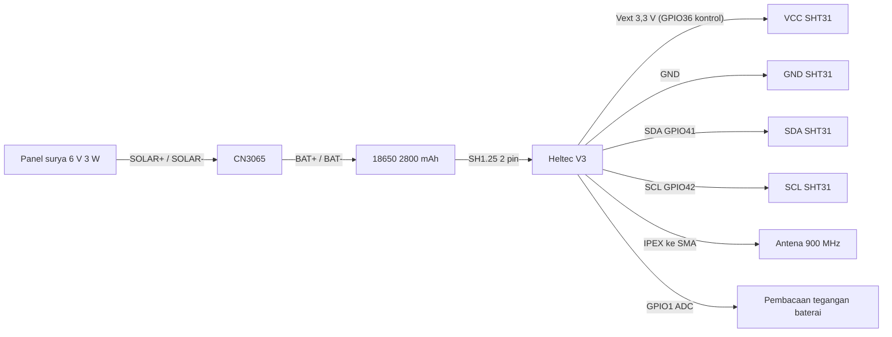

| Dari | Ke | Keterangan |
| --- | --- | --- |
| Vext (3,3 V) | VCC SHT31 | Vext dikontrol GPIO36, dimatikan saat tidur agar sensor tidak menguras baterai ([ESPHome Heltec V3](https://devices.esphome.io/devices/heltec-wifi-lora-32-v3/)) |
| GND | GND SHT31 | Ground bersama |
| GPIO41 / GPIO42 | SDA / SCL SHT31 | Bus I2C kedua **\[Usulan, cek pinout resmi Heltec\]**; bus pertama (GPIO17/18) dipakai OLED |
| ADDR SHT31 | GND | Alamat 0x44 |
| GPIO1 | Pembagi tegangan baterai onboard | Untuk telemetri baterai |
| IPEX | Pigtail SMA ke antena | Antena di luar kotak, tegak lurus |

**Mekanisme kerja firmware \[Usulan\]:**

1. Bangun dari deep sleep tiap **5 menit**, nyalakan Vext, tunggu 20 ms, baca SHT31 mode high repeatability sebanyak 3 kali, ambil median.
2. Simpan bacaan ke ring buffer di RTC memory (maksimal 48 bacaan, sekitar 4 jam).
3. Tiap **10 menit** (setiap 2 bacaan), kirim uplink LoRaWAN tanpa konfirmasi berisi 2 bacaan terakhir.
4. Matikan Vext dan radio, kembali deep sleep.

**Format payload 12 byte \[Usulan\]:** versi (1 B), nomor urut (2 B), suhu sekarang int16 x0,01 °C (2 B), RH sekarang uint16 x0,01 % (2 B), suhu sebelumnya (2 B), RH sebelumnya (2 B), tegangan baterai uint8 (1 B).

**Airtime dan batas jaringan \[Fakta, dihitung dengan rumus Semtech\]:** paket 25 byte di udara (12 B payload + 13 B overhead LoRaWAN) memakan sekitar 62 ms pada SF7, 206 ms pada SF9, dan 412 ms pada SF10. Dengan 144 paket per hari, total airtime sekitar 9 detik (SF7), 30 detik (SF9), atau 59 detik (SF10). The Things Network membatasi 30 detik uplink per node per hari ([TTN Fair Use](https://www.thethingsnetwork.org/forum/t/the-things-network-fair-use-policy/47689)), jadi **interval 10 menit hanya aman di TTN jika node memakai SF7-SF8**. Inilah alasan network server dijalankan sendiri dengan ChirpStack (Bagian 7).

**Saat koneksi gagal:**

- Node memakai LinkCheckReq sekali per 6 jam. Jika 3 kali gagal, node masuk mode "backlog": bacaan tetap disimpan, lalu dikirim sebagai paket ringkasan (min/maks/rata-rata per jam) setelah jaringan pulih.
- Jika tidak ada respons 24 jam, node melakukan rejoin OTAA.
- Watchdog timer me-reset MCU jika firmware macet.
- Server menandai node "terlambat" bila tidak ada data 30 menit dan "offline" bila 2 jam (Bagian 13).

**Anggaran daya \[Asumsi, wajib diukur di prototype\]:** dengan tidur 0,5 mA, 2 kali bangun baca 1 detik pada 40 mA, dan 1 kali kirim sekitar 2 detik pada 40 mA plus 0,2 detik TX pada 120 mA per 10 menit, arus rata-rata sekitar 0,8 mA atau 19 mAh per hari. Baterai 2800 mAh secara teori bertahan sekitar 2 bulan tanpa matahari setelah derating 50%. Panel 3 W sudah jauh melebihi kebutuhan, sehingga ukuran panel bisa diturunkan setelah pengukuran nyata.

### 5.4 Perlindungan perangkat

Pelindung radiasi adalah komponen paling penting setelah sensor. Sensor yang terkena matahari langsung akan membaca suhu dirinya sendiri, bukan suhu udara. Pelindung standar memakai permukaan luar putih memantulkan cahaya dan kisi-kisi yang tetap mengalirkan udara ([Observator OMC-422](https://www.nauticexpo.com/prod/skyview-systems/product-63248-473723.html)). Satu studi melaporkan pelindung berupa tabung PVC putih vertikal masih menaikkan bacaan 3-5 °C ([University of Malta](https://www.um.edu.mt/library/oar/handle/123456789/89169)). **\[Fakta\]**

| Risiko | Mitigasi \[Usulan\] |
| --- | --- |
| Radiasi matahari langsung dan pantulan | Shield bertingkat dari piring pot putih (6-8 lapis), celah 15-20 mm, sensor di tengah; jangan pakai kotak tertutup |
| Panas dari dinding/atap | Pasang di bracket menjauh minimal 50 cm dari dinding, tidak di atas atap seng, jauh dari outdoor AC dan dapur |
| Hujan | Kotak ABS dengan cable gland, lubang kabel menghadap ke bawah, drip loop pada kabel |
| Kelembapan dan embun | Silica gel di kotak, conformal coating pada PCB, ventilasi breather kecil |
| Debu | Bersihkan shield tiap 3 bulan; SHT31 dipasang dengan filter membran jika tersedia |
| Suhu tinggi | Baterai dan elektronik di kotak yang ternaungi panel surya, bukan di dalam shield |
| Pencurian dan vandalisme | Tinggi 2-2,5 m, baut kepala khusus, label "Aset Kelurahan X / Kampung Adem" dengan nomor kontak, titik dipilih di pekarangan pengurus RT/RW |
| Ketinggian ukur | Standar meteorologi 1,25-2 m; di kampung padat dipakai 2-2,5 m sebagai kompromi keamanan dan dicatat di metadata node |

**Kalibrasi \[Usulan\]:** sebelum dipasang, semua node diletakkan berdampingan bersama satu termohigrometer referensi selama 48 jam. Selisih rata-rata tiap node disimpan sebagai `offset_temp` dan `offset_rh` di database dan dikoreksi di backend, bukan di firmware.

## 6. Hardware Bill of Materials

Total hardware: **prototype Rp16,4 juta (5 node, 1 gateway)**, **pilot Rp46,6 juta (20 node, 2 gateway)**, **implementasi awal Rp118,2 juta (50 node, 5 gateway)**. Harga satuan dari Bagian 5.2, dicek 2 November 2026; harga grosir untuk 20-50 unit kemungkinan lebih rendah.

**Komponen paket per kategori (per unit):**

| Paket | Isi | Harga per unit | Status harga |
| --- | --- | --- | --- |
| Elektronik sensor node | Heltec V3 Rp556.200 + SHT31 Rp62.000 + antena Rp75.000 + kabel/konektor Rp60.000 | Rp753.200 | Heltec dan SHT31 terverifikasi, sisanya asumsi |
| Power per node | Baterai Rp79.900 + panel Rp78.000 + CN3065 Rp35.000 + holder Rp15.000 | Rp207.900 | Baterai dan panel terverifikasi |
| Enclosure dan instalasi per node | Box Rp85.995 + shield Rp75.000 + bracket Rp100.000 | Rp260.995 | Box terverifikasi |
| Gateway | Dragino LPS8N AS923 | Rp4.750.000 | Terverifikasi ([Tokopedia](https://www.tokopedia.com/rosesana/dragino-lps8n-indoor-lorawan-gateway-us915-as923)) |
| Infrastruktur komunikasi per gateway | Antena gateway outdoor + kabel low-loss Rp750.000, modem/router 4G cadangan Rp450.000 | Rp1.200.000 | **\[Asumsi\]** |
| UPS mini per gateway | UPS DC 12 V/5 V untuk router dan gateway | Rp350.000 | **\[Asumsi\]** |
| Box outdoor gateway (implementasi) | Durabox 190x290x140 mm IP66 | Rp429.030 | Terverifikasi ([Tokopedia Indolistrik](https://www.tokopedia.com/indolistrik-tng/abs-junction-box-plastik-190x290x140mm-abu-abu-base-plate-durabox)) |

**Rincian tiga skenario (Rupiah):**

| Kategori | Prototype (5 node, 1 GW) | Pilot (20 node, 2 GW) | Implementasi awal (50 node, 5 GW) |
| --- | --- | --- | --- |
| 1. Sensor node (elektronik) | 3.766.000 | 15.064.000 | 37.660.000 |
| 2. Gateway | 4.750.000 | 9.500.000 | 23.750.000 |
| 3. Infrastruktur komunikasi | 1.200.000 | 2.400.000 | 8.145.150 (termasuk box outdoor) |
| 4. Power supply (node + UPS gateway) | 1.389.500 | 4.858.000 | 12.145.000 |
| 5. Enclosure dan instalasi | 1.304.975 | 7.219.900 (termasuk jasa pasang Rp100 ribu/titik) | 18.049.750 (termasuk jasa pasang) |
| 6. Peralatan tambahan | 2.500.000 (alat kerja + termohigrometer referensi) | 1.500.000 | 3.000.000 |
| Subtotal | 14.910.475 | 40.541.900 | 102.749.900 |
| 7. Cadangan kerusakan/penggantian | 1.491.048 (10%) | 6.081.285 (15%) | 15.412.485 (15%) |
| **Total** | **16.401.523** | **46.623.185** | **118.162.385** |

**Asumsi perhitungan:**

- Prototype memakai Wi-Fi/internet mitra yang sudah ada di lokasi gateway; modem 4G hanya cadangan.
- Pilot: 20 node tersebar di sekitar 5-10 RW dalam 1-2 kelurahan, 1 gateway per kelurahan.
- Implementasi awal: 50 node di 2-3 kecamatan, 5 gateway termasuk 1 gateway cadangan untuk overlap cakupan.
- Cadangan 15% di pilot dan implementasi menutup kerusakan, pencurian, dan selisih harga.
- Belum termasuk ongkos kirim, PPN di luar harga marketplace, dan biaya sertifikasi perangkat (Bagian 20).

**Opsi hemat untuk prototype \[Usulan\]:** jika dana belum cukup untuk gateway Rp4,75 juta, uji awal bisa memakai mode LoRa point-to-point dengan satu Heltec V3 tambahan sebagai penerima yang meneruskan data lewat Wi-Fi (sekitar Rp556 ribu). Mode ini hanya untuk uji bench dan uji jangkauan, karena tidak memiliki enkripsi, deduplikasi, dan manajemen perangkat LoRaWAN.

## 7. Network Architecture

Rekomendasi final: **LoRaWAN privat pada plan AS923-2, network server ChirpStack yang dijalankan sendiri, satu gateway per kelurahan dengan antena di titik tertinggi, dan internet mitra dengan cadangan 4G.**

### 7.1 Regulasi frekuensi di Indonesia

- LPWAN termasuk kelompok perangkat berizin kelas dalam Permenkominfo No. 2 Tahun 2023 ([peraturan.go.id](https://peraturan.go.id/files/permenkominfo-no-2-tahun-2023.pdf)), yang mencabut Permenkominfo No. 1 Tahun 2019 ([BPK](https://peraturan.bpk.go.id/Home/Details/255564/permenkominfo-no-2)). **\[Fakta\]**
- Pita LPWA yang dipakai di Indonesia adalah 920-923 MHz; rancangan lampiran regulasi 2018 mencantumkan daya uplink maksimum 250 mW ERP ([Kominfo, draft RPM 2018](https://web.kominfo.go.id/sites/default/files/users/3997/LAMPIRAN%20II%20RPM%20IZIN%20KELAS-KP%202018%20%5B24092018%5D.pdf)). **\[Fakta untuk draft; nilai final wajib dicek di lampiran Permen 2/2023 dan standar teknis SDPPI\]**
- LoRa Alliance mendefinisikan AS923-2 sebagai plan AS923 yang digeser turun 1,8 MHz untuk Indonesia dan Vietnam ([LoRa Alliance RP2-1.0.1](https://lora-alliance.org/?p=5981)). **\[Fakta\]**
- Perangkat yang dipakai untuk layanan resmi pemerintah idealnya bersertifikat SDPPI; untuk riset/prototype mahasiswa ini dicatat sebagai risiko (Bagian 20).

### 7.2 LoRa point-to-point vs LoRaWAN

| Aspek | LoRa P2P | LoRaWAN |
| --- | --- | --- |
| Arsitektur | Node bicara langsung ke satu penerima | Node, gateway, network server, application server |
| Keamanan | Harus dibuat sendiri | AES-128 bawaan (NwkSKey, AppSKey) |
| Banyak gateway | Sulit, duplikasi ditangani sendiri | Deduplikasi otomatis oleh network server |
| Manajemen perangkat | Manual | Join OTAA, ADR, status perangkat |
| Kapasitas | Satu kanal | Gateway 8 kanal, ratusan node |
| Biaya awal | Sangat murah (penerima Rp556 ribu) | Gateway Rp4,75 juta |
| Kesiapan skala pemerintah | Rendah | Tinggi, standar terbuka |

**Keputusan:** LoRaWAN untuk semua tahap. P2P hanya untuk uji jangkauan minggu pertama.

### 7.3 Jangkauan dan jumlah gateway

- Pemetaan sinyal 920-923 MHz di kampus UGM (lingkungan urban) mencatat jarak terjauh **1,242 km**, dengan RSSI terendah -107 dB ([UGM ETD](https://etd.repository.ugm.ac.id/home/detail_pencarian_downloadfiles/505364)). **\[Fakta\]**
- Kampung padat Surabaya kemungkinan mirip atau lebih buruk karena atap rapat dan gang sempit. Asumsi desain: **radius andal 0,8-1,5 km** dari gateway dengan antena di ketinggian 10-15 m. **\[Asumsi, diverifikasi lewat survei RSSI\]**
- Satu RW di kampung padat biasanya hanya ratusan meter; satu gateway yang baik dapat mencakup beberapa RW di satu kelurahan. **\[Asumsi\]**
- Kapasitas bukan masalah: 50 node x 144 paket/hari pada SF7-SF9 masih jauh di bawah kapasitas gateway 8 kanal.

**Jumlah node ideal per RW \[Usulan\]:** 2 node untuk prototype/pilot (agar bisa saling cek), 3-5 node untuk RW yang luas atau heterogen (gang padat vs tepi jalan vs dekat RTH).

### 7.4 Penentuan posisi gateway

1. Kandidat: kantor kelurahan lantai 2+, menara masjid/gereja, gedung sekolah, atau tower mitra, dengan izin tertulis.
2. Antena gateway di luar ruangan, setinggi mungkin, tidak terhalang dinding beton dekat antena.
3. Survei lapangan: bawa node uji yang mengirim paket tiap 30 detik, catat RSSI/SNR di tiap calon titik sensor.
4. Kriteria lolos: RSSI di atas -115 dBm dan SNR di atas -10 dB pada SF9 **\[Usulan\]**. Jika titik gagal, tambah gateway atau pindah titik.
5. Di implementasi, pastikan setiap node terdengar oleh minimal 2 gateway jika memungkinkan.

### 7.5 Koneksi gateway ke internet

| Prioritas | Jalur | Catatan |
| --- | --- | --- |
| 1 | Ethernet ke router kelurahan/balai RW | Paling stabil, perlu izin TI kelurahan |
| 2 | Wi-Fi client ke jaringan mitra | Mudah, rawan putus jika router mati |
| 3 | Modem/router 4G | Cadangan saat jalur 1/2 putus |

Gateway terhubung ke ChirpStack lewat MQTT forwarder dengan TLS ([ChirpStack: Dragino](https://chirpstack.io/docs/gateway-configuration/dragino.html)).

### 7.6 Mengapa ChirpStack, bukan TTN publik

| Aspek | TTN Community | ChirpStack self-hosted |
| --- | --- | --- |
| Biaya | Gratis | Gratis (open source), jalan di VPS yang sama |
| Batas airtime | 30 detik uplink/hari, 10 downlink/hari per node ([TTN](https://www.thethingsnetwork.org/forum/t/the-things-network-fair-use-policy/47689)) | Hanya batas regulasi |
| Kendali data | Data lewat server pihak ketiga | Data di server sendiri |
| Kemudahan awal | Sangat mudah | Perlu setup Docker |

**Keputusan:** minggu-minggu awal prototype boleh memakai TTN untuk belajar. Mulai akhir prototype, pindah ke ChirpStack.

### 7.7 Mengantisipasi kehilangan paket

- **Redundansi data:** setiap paket membawa 2 bacaan, sehingga hilangnya 1 paket tidak menghilangkan data.
- **Nomor urut:** server mendeteksi celah dari `seq` dan mencatat persentase paket diterima per node.
- **ADR:** network server menurunkan SF untuk node bersinyal kuat agar airtime kecil.
- **Backlog:** node mengirim ringkasan per jam setelah jaringan pulih (Bagian 5.3).
- **Multi-gateway:** pada implementasi, overlap cakupan mengurangi titik buta.
- **Tanpa konfirmasi:** uplink tidak meminta ACK agar tidak menghabiskan kapasitas downlink gateway.

## 8. Software Architecture

Rekomendasi final: **backend Python FastAPI (API + ingest) dan worker Python terpisah dalam satu repo, frontend React + Vite + TypeScript, komunikasi REST + GeoJSON dengan polling 60 detik.**

### 8.1 Backend

| Kriteria | FastAPI | Django | Node.js Express/NestJS |
| --- | --- | --- | --- |
| Integrasi IoT (MQTT) | paho-mqtt/aiomqtt, async | Bisa, kurang natural untuk async | MQTT.js sangat matang |
| Olah data sensor | pandas, numpy native | pandas native | Perlu library tambahan, ekosistem data lemah |
| Data satelit | earthengine-api, rasterio, geopandas native | Sama (Python) | Tidak ada setara rasterio yang matang |
| Interpolasi spasial | scipy, pykrige | Sama | Terbatas |
| API | OpenAPI/Swagger otomatis, validasi Pydantic | DRF matang, admin bawaan | NestJS terstruktur, Express bebas |
| Kemudahan tim mahasiswa | Ringan, cepat dipelajari | Lebih berat, banyak konvensi | Mudah jika tim kuat JS |
| Maintenance | Baik, kode eksplisit | Sangat baik untuk CRUD besar | Baik |

**Keputusan: FastAPI.** Alasan utamanya bukan popularitas, tetapi karena **satu bahasa (Python) menangani ingest, statistik, raster satelit, dan interpolasi**. Django tidak dipilih karena fitur andalannya (admin, ORM CRUD) bukan bagian tersulit sistem ini. Node.js tidak dipilih karena pemrosesan raster dan spasial akan memaksa layanan Python kedua.

**Struktur layanan \[Usulan\]:**

| Layanan | Tanggung jawab | Teknologi |
| --- | --- | --- |
| `api` | REST API, autentikasi, manajemen data | FastAPI, SQLAlchemy 2, Pydantic, Alembic |
| `ingest` | Subscribe MQTT ChirpStack, decode payload, simpan | aiomqtt di dalam proses FastAPI atau proses terpisah |
| `worker` | Agregasi 10 menit/jam, heat index, interpolasi, status, tarik GEE, kirim WA | APScheduler, pandas, scipy, earthengine-api, httpx |
| `chirpstack` | Network server LoRaWAN | Image resmi ChirpStack v4 + Mosquitto + Redis |
| `db` | Penyimpanan | PostgreSQL + TimescaleDB + PostGIS |
| `web` | Frontend statis + reverse proxy | nginx |

Redis sudah wajib untuk ChirpStack, sehingga bisa dipakai juga untuk cache ringkasan dashboard dan rate-limit tanpa biaya tambahan.

### 8.2 Frontend

| Kriteria | React (Vite) | Next.js | Vue.js |
| --- | --- | --- | --- |
| Kebutuhan SEO/SSR | Tidak perlu (dashboard di balik login) | Unggul, tetapi tidak dibutuhkan | Tidak perlu |
| Ekosistem peta | react-leaflet matang | Sama, perlu atur SSR untuk Leaflet | vue-leaflet ada |
| Deploy | File statis di nginx | Perlu server Node atau export statis | File statis |
| Kurva belajar | Sedang | Lebih tinggi | Rendah |
| Pengalaman tim | Tim punya pengalaman frontend React (asumsi) |  |  |

**Keputusan: React + Vite + TypeScript**, dengan TanStack Query (fetch + cache), react-leaflet, Recharts/ECharts untuk grafik, dan Tailwind CSS. Next.js dipertimbangkan kembali hanya jika halaman publik tanpa login menjadi prioritas.

**Komunikasi frontend-backend:**

| Kebutuhan | Mekanisme | Alasan |
| --- | --- | --- |
| Data peta, sensor, riwayat | REST JSON + GeoJSON | Data berubah tiap 10 menit, tidak perlu push |
| Pembaruan otomatis dashboard | Polling 60 detik via TanStack Query | Sederhana, cukup untuk interval 10 menit |
| Notifikasi status baru di dashboard | Server-Sent Events (opsional di pilot) | Lebih ringan dari WebSocket, satu arah |
| Autentikasi | JWT akses (15 menit) + refresh token httpOnly cookie | Aman dari XSS untuk refresh token |

WebSocket tidak dipakai karena tidak ada interaksi dua arah real-time.

### 8.3 API design

Semua endpoint di bawah `/api/v1`, format JSON, waktu dalam ISO 8601 UTC+7, suhu dalam °C. Endpoint di bawah ini adalah usulan.

**1) `GET /api/v1/sensors`** · daftar sensor node beserta status terakhir.

Parameter: `rw_id` (opsional), `status` (`online|late|offline`), `page`, `page_size`.

```json
{
  "items": [
    {
      "id": "KA-SBY-0012",
      "name": "RW03 Gang Mawar",
      "rw_id": 301,
      "location": {"lat": -7.2575, "lon": 112.7521},
      "mount_height_m": 2.2,
      "status": "online",
      "last_seen": "2026-11-02T13:40:00+07:00",
      "battery_v": 3.98,
      "rssi": -104,
      "last_reading": {"temp_c": 34.6, "rh_pct": 61.2, "heat_index_c": 41.8}
    }
  ],
  "total": 1, "page": 1, "page_size": 50
}
```

**2) `GET /api/v1/sensors/{id}/readings`** · riwayat bacaan satu sensor.

Parameter: `from`, `to` (wajib), `interval` (`raw|10m|1h|1d`, default `10m`), `fields`.

```json
{
  "sensor_id": "KA-SBY-0012",
  "interval": "1h",
  "points": [
    {"ts": "2026-11-02T12:00:00+07:00", "temp_c_avg": 34.9, "temp_c_max": 35.6, "rh_pct_avg": 59.8, "heat_index_c_max": 43.1, "qc_flag": "ok"},
    {"ts": "2026-11-02T13:00:00+07:00", "temp_c_avg": 35.2, "temp_c_max": 35.9, "rh_pct_avg": 58.4, "heat_index_c_max": 43.4, "qc_flag": "ok"}
  ]
}
```

**3) `POST /api/v1/sensors/readings`** · menerima bacaan. Dipakai integrasi HTTP ChirpStack atau node Wi-Fi uji; dilindungi API key per integrasi.

Request body:

```json
{
  "dev_eui": "70B3D57ED0051234",
  "received_at": "2026-11-02T13:40:02+07:00",
  "f_cnt": 2291,
  "payload_hex": "01 08F3 0D7A 17D8 0D86 17C0 B6",
  "gateways": [{"gateway_id": "GW-KEL-01", "rssi": -104, "snr": -6.5}]
}
```

Response `201`:

```json
{"accepted": 2, "sensor_id": "KA-SBY-0012", "qc": ["ok", "ok"]}
```

**4) `GET /api/v1/heatmap`** · peta panas per RW sebagai GeoJSON.

Parameter: `level` (`rw|kelurahan`), `kecamatan_id`, `at` (waktu, default terbaru), `layer` (`air|lst|combined`).

```json
{
  "type": "FeatureCollection",
  "generated_at": "2026-11-02T13:50:00+07:00",
  "lst_scene_date": "2026-10-24",
  "features": [
    {
      "type": "Feature",
      "geometry": {"type": "MultiPolygon", "coordinates": [[[[112.75, -7.25], [112.76, -7.25], [112.76, -7.26], [112.75, -7.25]]]]},
      "properties": {
        "rw_id": 301, "name": "RW 03, Kel. X",
        "air_temp_c": 35.1, "heat_index_c": 42.7, "lst_c": 44.9,
        "estimate_method": "sensor", "n_sensors": 2,
        "status": "SIAGA", "confidence": "tinggi"
      }
    }
  ]
}
```

**5) `GET /api/v1/regions`** · hierarki wilayah.

Parameter: `level` (`kecamatan|kelurahan|rw`), `parent_id`, `include_geometry` (bool).

```json
{"items": [{"id": 301, "level": "rw", "code": "357812xxxx-03", "name": "RW 03", "parent_id": 31, "population": 2140, "vulnerable_count": 312}]}
```

**6) `GET /api/v1/alerts`** · daftar peringatan.

Parameter: `rw_id`, `status` (`active|resolved`), `level` (`WASPADA|SIAGA|AWAS`), `from`, `to`.

```json
{
  "items": [
    {
      "id": 8812, "rw_id": 301, "level": "SIAGA",
      "started_at": "2026-11-02T12:20:00+07:00", "resolved_at": null,
      "trigger": {"heat_index_c": 42.7, "rule": "HI>=41 selama 30 menit, 2 sensor"},
      "notifications": {"sent": 6, "delivered": 5, "failed": 1}
    }
  ]
}
```

**7) `POST /api/v1/alerts`** · membuat peringatan manual (mis. kelurahan meneruskan imbauan BMKG/Dinkes). Hak akses: admin, kelurahan.

Request body:

```json
{"rw_ids": [301, 302], "level": "WASPADA", "source": "manual_bmkg", "note": "Prakiraan BMKG suhu maksimum 36 C besok", "send_whatsapp": true}
```

Response `201`:

```json
{"id": 8813, "queued_notifications": 12}
```

**8) `GET /api/v1/dashboard/summary`** · angka ringkas halaman utama.

Parameter: `kecamatan_id` (opsional, dibatasi oleh hak akses).

```json
{
  "as_of": "2026-11-02T13:50:00+07:00",
  "rw_by_status": {"NORMAL": 4, "WASPADA": 9, "SIAGA": 2, "AWAS": 0, "TIDAK_ADA_DATA": 1},
  "hottest_rw": {"rw_id": 301, "name": "RW 03, Kel. X", "heat_index_c": 42.7},
  "sensors": {"online": 18, "late": 1, "offline": 1},
  "active_alerts": 2,
  "wa_sent_today": 12,
  "bmkg_reference": {"station": "Juanda", "temp_c": 34.0, "source_ts": "2026-11-02T13:00:00+07:00"}
}
```

**Endpoint pendukung \[Usulan\]:** `POST /api/v1/auth/login`, `POST /api/v1/auth/refresh`, `GET/POST/PATCH /api/v1/recipients`, `GET/PUT /api/v1/thresholds`, `GET/POST /api/v1/maintenance-logs`, `POST /api/v1/webhooks/whatsapp` (status pengiriman dari Meta), `GET /api/v1/reports/monthly?format=pdf|csv`.

## 9. Database Design

Rekomendasi final: **satu instance PostgreSQL dengan ekstensi PostGIS (spasial) dan TimescaleDB (time-series), ditambah Redis yang sudah ikut dengan ChirpStack untuk cache.** Satu image Docker `timescale/timescaledb-ha` sudah membawa kedua ekstensi.

### 9.1 Kebutuhan jenis database

| Jenis | Dibutuhkan? | Untuk apa | Solusi |
| --- | --- | --- | --- |
| Relational | Ya | Pengguna, peran, wilayah, perangkat, penerima, alert | PostgreSQL |
| Spatial | Ya | Batas RW, titik sensor, query "sensor di dalam RW", GeoJSON | PostGIS |
| Time-series | Ya | Jutaan bacaan per tahun, agregasi 10 menit/jam/hari | TimescaleDB hypertable + continuous aggregate |
| Caching | Ringan | Ringkasan dashboard, rate-limit API | Redis |

**Mengapa tidak InfluxDB:** InfluxDB kuat untuk time-series, tetapi tidak punya fungsi spasial dan join relasional. Memakainya berarti dua database dan sinkronisasi ID. Volume data Kampung Adem kecil: 50 node x 288 bacaan/hari sekitar 5,3 juta baris/tahun, ringan untuk PostgreSQL. **\[Fakta, hitungan\]**

### 9.2 ERD

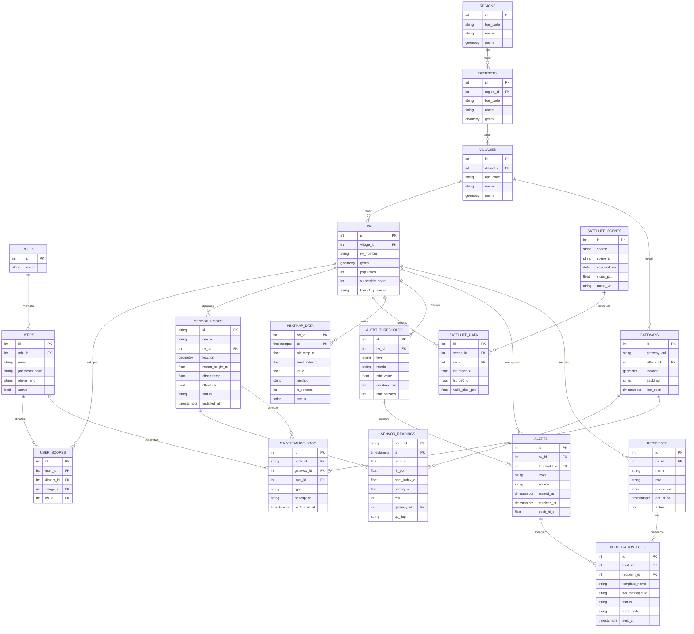

### 9.3 Penjelasan tabel

| Tabel | PK | FK utama | Mengapa diperlukan |
| --- | --- | --- | --- |
| `roles` | id | - | Lima peran: admin, kelurahan, rtrw, kader, teknis |
| `users` | id | role\_id | Akun login dashboard |
| `user_scopes` | id | user\_id, district\_id/village\_id/rw\_id | Membatasi data yang boleh dilihat (mis. lurah hanya kelurahannya) |
| `regions` | id | - | Kota/kabupaten (Surabaya), siap jika ekspansi kota lain |
| `districts` | id | region\_id | Kecamatan, dengan geometri batas |
| `villages` | id | district\_id | Kelurahan, dengan geometri batas |
| `rw` | id | village\_id | Unit pemantauan utama, populasi dan jumlah warga rentan (dari kader) |
| `gateways` | id | village\_id | Inventaris gateway, status online |
| `sensor_nodes` | id (kode KA-SBY-xxxx) | rw\_id | Inventaris node, lokasi, offset kalibrasi |
| `sensor_readings` | (node\_id, ts) | node\_id, gateway\_id | Hypertable TimescaleDB, data mentah + flag QC |
| `satellite_scenes` | id | - | Metadata tiap citra Landsat/MODIS yang diproses |
| `satellite_data` | id | scene\_id, rw\_id | Statistik LST per RW per citra (zonal statistics) |
| `heatmap_data` | (rw\_id, ts) | rw\_id | Hasil estimasi per RW tiap 10 menit, sumber peta dan status |
| `alert_thresholds` | id | rw\_id (nullable) | Ambang global (rw\_id kosong) atau khusus RW, versi tercatat |
| `alerts` | id | rw\_id, threshold\_id | Kejadian status naik/turun, otomatis atau manual |
| `recipients` | id | rw\_id | Penerima WA per RW, dengan bukti opt-in |
| `notification_logs` | id | alert\_id, recipient\_id | Jejak tiap pesan WA dan status dari webhook Meta |
| `maintenance_logs` | id | node\_id/gateway\_id, user\_id | Riwayat perawatan dan penggantian |

**Detail teknis \[Usulan\]:**

- Semua geometri dalam SRID 4326 dan diberi indeks GiST.
- `sensor_readings` dijadikan hypertable dengan chunk 7 hari, kompresi setelah 30 hari, dan continuous aggregate `readings_10m`, `readings_1h`, `readings_1d`.
- `phone_enc` dienkripsi di level aplikasi (AES-GCM, kunci di environment variable), plus kolom `phone_hash` untuk pencarian unik.
- Kode wilayah mengikuti kode BPS/Kemendagri; batas RW sering tidak tersedia resmi, sehingga kolom `boundary_source` mencatat asalnya (digitasi bersama kelurahan, Pemkot, atau perkiraan).

## 10. Data Processing and Satellite Integration

Data mentah diproses dalam tiga lapis: **QC per bacaan, agregasi per 10 menit, lalu estimasi per RW** yang menggabungkan sensor dengan LST satelit. Metodenya sengaja sederhana untuk prototype dan bisa ditingkatkan di pilot.

### 10.1 Suhu udara vs Land Surface Temperature

| Aspek | Suhu udara (sensor) | LST (satelit) |
| --- | --- | --- |
| Yang diukur | Suhu udara pada ketinggian 2 m | Suhu radiatif permukaan (atap, jalan, tanah) |
| Nilai siang hari | Lebih rendah | Bisa jauh lebih tinggi, terutama atap seng dan aspal |
| Waktu | Kontinu tiap 5 menit | Satu potret saat satelit lewat, hanya jika cerah |
| Resolusi | Satu titik | Piksel 30 m (Landsat, thermal asli 100 m) atau 1 km (MODIS) |
| Fungsi di sistem | Dasar status dan peringatan | Peta latar pola panas, pemilihan lokasi, kovariat interpolasi |

**Aturan sistem:** LST tidak pernah dipakai langsung untuk memicu WhatsApp, dan tidak pernah ditampilkan dengan label "suhu udara".

### 10.2 Pipeline data sensor

**Validasi per bacaan (flag QC) \[Usulan\]:**

| Cek | Aturan | Hasil |
| --- | --- | --- |
| Rentang | Suhu di luar 15-50 °C atau RH di luar 5-100% | `invalid` |
| Lonjakan | Perubahan suhu lebih dari 3 °C dalam 5 menit | `suspect` |
| Macet | Nilai sama persis 6 bacaan berturut-turut | `suspect` |
| Kondensasi | RH di atas 99% lebih dari 2 jam | `suspect` |
| Baterai | Tegangan di bawah 3,3 V | `suspect` |
| Tetangga | Selisih lebih dari 4 °C dari median node lain di kelurahan yang sama pada jam yang sama | `suspect` |

Hanya bacaan `ok` yang dipakai untuk status. Bacaan `suspect` tetap disimpan dan ditampilkan ke tim teknis.

**Deteksi anomali:** robust z-score berbasis median absolute deviation (MAD) terhadap node se-kelurahan. Node dengan |z| di atas 3,5 selama lebih dari 1 jam memunculkan tiket "cek perangkat" di dashboard teknis.

**Data kosong:** tidak ada pengisian nilai palsu. Grafik menampilkan celah. Agregat per jam hanya dihitung jika minimal 70% bacaan tersedia. RW tanpa bacaan valid 30 menit terakhir masuk tier estimasi berikutnya (10.5).

**Agregasi:** continuous aggregate TimescaleDB per 10 menit, 1 jam, dan 1 hari, berisi rata-rata, maksimum, minimum suhu/RH, heat index maksimum, dan jumlah menit di atas ambang.

**Heat index:** dihitung tiap bacaan dengan regresi Rothfusz yang dipakai NWS/NOAA (suhu T dalam °F, RH dalam %), lalu dikonversi ke °C. Untuk nilai di bawah 80 °F dipakai rumus sederhana Steadman, sesuai prosedur NWS.

```latex
HI = -42.379 + 2.04901523T + 10.14333127RH - 0.22475541\,T\,RH - 0.00683783T^2 - 0.05481717RH^2 + 0.00122874T^2RH + 0.00085282\,T\,RH^2 - 0.00000199T^2RH^2
```

### 10.3 Sumber data satelit

| Sumber | Resolusi spasial | Resolusi temporal | Akses | Kegunaan untuk Kampung Adem |
| --- | --- | --- | --- | --- |
| **Landsat 8/9 Collection 2 Level-2 ST** | 30 m (thermal asli 100 m) | 16 hari per satelit, 8 hari gabungan ([Sentinel Hub](https://docs.sentinel-hub.com/api/latest/data/landsat-8-l2/)) | Gratis, GEE/EarthExplorer | **Sumber utama** peta LST per RW |
| MODIS MOD11A1 v061 | sekitar 1 km | Harian, siang dan malam ([GEE catalog](https://developers.google.com/earth-engine/datasets/catalog/MODIS_MOD11A1)) | Gratis, GEE | Konteks harian dan pola malam skala kecamatan |
| Sentinel-2 | 10-20 m | sekitar 5 hari | Gratis | Tidak punya kanal termal ([BIG Piksel](https://piksel.big.go.id/en/docs/data_products/baseline_satellite/surface_temperature/)); dipakai untuk NDVI/tutupan lahan |
| BIG Piksel (Landsat ST) | 30 m | Mengikuti Landsat | Platform data nasional | Alternatif/validasi sumber lokal |

Landsat 9 Level-2 tersedia sekitar 3 hari setelah akuisisi ([USGS Level-2](https://usgs.gov/land-resources/nli/landsat/landsat-collection-2-level-2-science-products)). Data LST Landsat 8 tersedia sejak April 2013 dan Landsat 9 sejak Januari 2022 ([USGS EROS](https://www.usgs.gov/centers/eros/science/usgs-eros-archive-landsat-archives-landsat-8-9-olitirs-collection-2-level-2)). **\[Fakta\]**

**Keputusan:** Landsat 8/9 lewat Google Earth Engine untuk LST per RW; MODIS sebagai konteks harian. GEE gratis untuk riset, pendidikan, dan nonprofit (tertera di [katalog GEE](https://developers.google.com/earth-engine/datasets/catalog/MODIS_006_MOD11A1?hl=zh-tw)); untuk operasional pemerintah jangka panjang perlu dicek skema lisensinya. **\[Fakta + Asumsi\]**

### 10.4 Alur pengolahan LST

1. **Ambil data.** Worker menjalankan skrip Earth Engine Python tiap hari: filter koleksi Landsat 8/9 C2 L2 untuk bounding box Surabaya, tanggal terbaru.
2. **Konversi ke °C.** Band `ST_B10` diskalakan dengan rumus USGS ST(K) = DN x 0,00341802 + 149,0 ([USGS](https://www.usgs.gov/landsat-missions/landsat-collection-2-surface-temperature)), lalu dikurangi 273,15.
3. **Masking awan.** Piksel dengan bit awan, bayangan awan, dan cirrus pada `QA_PIXEL` dibuang. Citra ditolak jika piksel valid di area studi kurang dari 60% **\[Usulan\]**.
4. **Potong per wilayah.** Batas kecamatan/kelurahan/RW diunggah sebagai asset FeatureCollection. Batas RW dipakai jika tersedia; jika tidak, dipakai batas kelurahan sambil digitasi RW bersama kelurahan.
5. **Zonal statistics.** `reduceRegions` menghitung rata-rata, persentil 90, dan persentase piksel valid per RW, lalu disimpan ke `satellite_data`.
6. **Raster untuk peta.** LST yang sudah dipotong diekspor sebagai Cloud-Optimized GeoTIFF dan dirender sebagai PNG overlay ber-legenda untuk Leaflet.
7. **Baseline multi-tahun.** Komposit median LST musim kemarau (Juni-Oktober) beberapa tahun dipakai sebagai lapisan "kerentanan panas permukaan" yang stabil dan juga untuk analisis tim dampak memilih 2-3 kecamatan.

**Frekuensi:** pengecekan citra baru tiap hari; citra layak pakai diperkirakan hanya 1-3 per bulan, lebih jarang di musim hujan karena awan. **\[Asumsi\]**

### 10.5 Estimasi per RW (penggabungan sensor dan LST)

| Tier | Kondisi | Metode | Label keyakinan |
| --- | --- | --- | --- |
| A | RW punya minimal 1 sensor valid dalam 30 menit | Rata-rata sensor valid di RW | Tinggi (2+ sensor) / Sedang (1 sensor) |
| B | Tidak ada sensor di RW, ada sensor dalam radius 2 km | IDW (power 2) dari sensor terdekat | Rendah |
| C (pilot, minimal 5 sensor aktif) | Seperti B | Regresi suhu udara terhadap LST baseline, residu di-IDW | Rendah-Sedang |
| D | Tidak ada sensor dalam 2 km | Hanya tampilkan LST, status "Tidak ada data sensor" | Tidak ada |

Model tier C dihitung ulang tiap 10 menit dari semua sensor aktif:

```latex
T_{air}(x,t) = a(t) + b(t)\cdot LST_{baseline}(x) + \varepsilon_{IDW}(x,t)
```

Jika R² di bawah 0,3 atau koefisien b negatif, sistem otomatis kembali ke tier B. **\[Usulan\]** Peringatan WhatsApp otomatis hanya dikirim untuk RW tier A; tier B/C hanya ditampilkan di dashboard sebagai "perkiraan".

### 10.6 Keterbatasan citra satelit

- **Bukan real-time:** satu potret per 8-16 hari, tersedia beberapa hari setelah akuisisi, dan sering tertutup awan.
- **Waktu lintas:** Landsat melintas pagi menjelang siang **\[Perlu verifikasi jam lintas\]**, sedangkan puncak panas udara umumnya sore hari.
- **Resolusi:** thermal asli 100 m; gang selebar 2 m tidak terlihat, satu piksel mencampur atap, jalan, dan pohon.
- **Celah data:** LST Landsat kosong di area tanpa data emisivitas ASTER GED ([USGS EROS](https://www.usgs.gov/centers/eros/science/usgs-eros-archive-landsat-archives-landsat-8-9-olitirs-collection-2-level-2)).
- **Fallback:** jika citra baru tidak ada, sistem tetap memakai baseline terakhir dan mencantumkan tanggal citra di peta (`lst_scene_date`).

## 11. WhatsApp Integration

Rekomendasi final: **WhatsApp Cloud API langsung dari Meta, dengan template kategori utility yang sudah disetujui, nomor khusus Kampung Adem, dan antrian pengiriman di backend.** Estimasi biaya: sekitar Rp53 ribu/bulan (prototype) dan Rp214 ribu/bulan (pilot).

### 11.1 Perbandingan opsi

| Opsi | Biaya platform | Biaya pesan | Kelebihan | Kekurangan | Keputusan |
| --- | --- | --- | --- | --- | --- |
| **WhatsApp Cloud API (Meta)** | Tidak ada | Tarif Meta per pesan | Resmi, dokumentasi lengkap, kontrol penuh | Setup Business Manager dan template sendiri | **Dipilih** |
| BSP resmi (mis. Qontak, Wati, Gupshup) | Langganan bulanan, mis. paket mulai Rp599 ribu di salah satu BSP ([Go4whatsup](https://www.go4whatsup.com/indonesia/whatsapp-business-api-pricing/)) | Tarif Meta + markup | Dashboard siap, dukungan lokal, bantu verifikasi | Biaya tetap bulanan | Cadangan jika verifikasi Meta sulit |
| Library otomatisasi WhatsApp Web tidak resmi | Gratis | Gratis | Mudah | Melanggar ketentuan WhatsApp, nomor bisa diblokir, tidak layak untuk layanan pemerintah | **Ditolak** |

### 11.2 Cara mendapatkan akses API

1. **Meta Business Portfolio.** Buat atas nama institusi (idealnya kelurahan/Pemkot saat pilot, atau organisasi mahasiswa/ITB saat prototype).
2. **Meta Developer App** dengan use case WhatsApp, lalu hubungkan ke **WhatsApp Business Account (WABA)** di halaman API Setup ([Meta Get Started](https://developers.facebook.com/documentation/business-messaging/whatsapp/get-started)). **\[Fakta\]**
3. **Uji dengan nomor tes** bawaan Meta dan template `hello_world`. Token sementara hanya untuk uji dan cepat kedaluwarsa.
4. **Token permanen:** buat **System User** di Business Settings, beri aset app dengan kontrol penuh, lalu generate token dengan izin `whatsapp_business_messaging` dan `whatsapp_business_management` ([Meta Get Started](https://developers.facebook.com/documentation/business-messaging/whatsapp/get-started.md)). **\[Fakta\]**
5. **Nomor khusus:** daftarkan nomor baru yang tidak sedang dipakai di aplikasi WhatsApp biasa, verifikasi lewat SMS/telepon. Gunakan nama tampilan "Kampung Adem".
6. **Verifikasi bisnis:** unggah dokumen legal institusi untuk menaikkan batas pengiriman dan mendapat nama tampilan yang terverifikasi. Proses ini paling realistis dilakukan bersama mitra pemerintah. **\[Asumsi\]**
7. **Metode pembayaran:** sejak perubahan 1 Oktober 2026, bisnis tanpa metode pembayaran berisiko pesan service dihentikan setelah kuota gratis habis ([Meta Pricing](https://developers.facebook.com/documentation/business-messaging/whatsapp/pricing)). **\[Fakta\]**
8. **Template:** ajukan template peringatan dalam bahasa Indonesia untuk persetujuan Meta.

### 11.3 Diagram alur integrasi

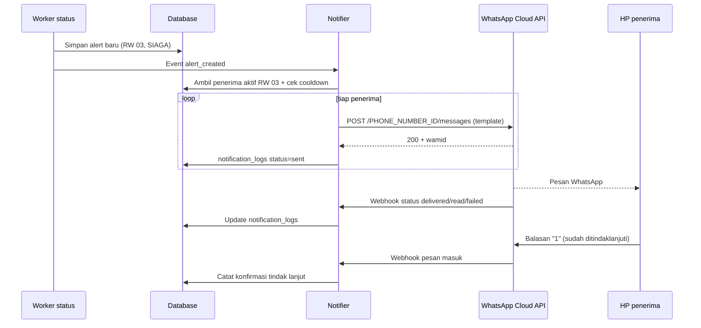

### 11.4 Cara backend mengirim pesan

Permintaan ke Graph API memakai header `Authorization: Bearer <SYSTEM_USER_TOKEN>`:

```json
POST https://graph.facebook.com/v23.0/<PHONE_NUMBER_ID>/messages
{
  "messaging_product": "whatsapp",
  "to": "6281234567890",
  "type": "template",
  "template": {
    "name": "peringatan_panas_rw",
    "language": {"code": "id"},
    "components": [{
      "type": "body",
      "parameters": [
        {"type": "text", "text": "SIAGA"},
        {"type": "text", "text": "RW 03, Kelurahan X"},
        {"type": "text", "text": "35,1"},
        {"type": "text", "text": "58"},
        {"type": "text", "text": "42,7"},
        {"type": "text", "text": "2 Nov 2026 13.40 WIB"}
      ]
    }]
  }
}
```

Versi Graph API mengikuti contoh dokumentasi Meta ([Get Started](https://developers.facebook.com/documentation/business-messaging/whatsapp/get-started)) dan perlu dicek saat implementasi.

### 11.5 Contoh template pesan

**Template `peringatan_panas_rw` (utility) \[Usulan\]:**

```markdown
PERINGATAN PANAS {{1}}

Wilayah: {{2}}
Suhu udara terukur: {{3}} °C
Kelembapan: {{4}}%
Indeks panas: {{5}} °C
Waktu pengukuran: {{6}}

Mohon kader dan pengurus RT/RW memperhatikan warga rentan, terutama lansia, balita, ibu hamil, dan pekerja luar ruang: ingatkan minum air, kurangi aktivitas di bawah matahari, dan cari tempat teduh.

Ini informasi lingkungan dari sensor Kampung Adem, bukan diagnosis kesehatan. Jika ada warga pusing berat, bingung, atau pingsan, segera hubungi puskesmas atau 112.

Balas 1 jika sudah ditindaklanjuti.
```

**Template `status_panas_turun` (utility):** "Status panas di {{1}} sudah turun ke {{2}} sejak {{3}}. Terima kasih atas tindak lanjutnya."

**Template `ringkasan_harian` (utility, opsional):** dikirim sekali sore hari hanya jika hari itu ada status SIAGA atau lebih tinggi.

### 11.6 Penentuan penerima per wilayah

- Setiap penerima di tabel `recipients` terikat ke satu atau beberapa `rw_id`, dengan peran (Ketua RW, Ketua RT, kader posyandu, staf kelurahan).
- Saat alert RW 03 muncul: kirim ke semua penerima aktif RW 03, dan staf kelurahan menerima ringkasan gabungan (bukan satu pesan per RW).
- **Opt-in wajib:** penerima menyetujui secara tertulis/formulir menerima pesan Kampung Adem, dan `opt_in_at` dicatat. Penerima bisa berhenti dengan membalas "STOP".

### 11.7 Penanganan kegagalan

| Kegagalan | Penanganan \[Usulan\] |
| --- | --- |
| HTTP 5xx / timeout dari Graph API | Retry eksponensial: 30 detik, 2 menit, 10 menit, maksimal 4 kali |
| HTTP 429 (rate limit) | Tunda dan kirim ulang lewat antrian Redis |
| Webhook status `failed` (nomor tidak terdaftar WA, dll.) | Tandai penerima, beri tahu admin di dashboard |
| Template ditolak/diubah kategorinya | Admin mendapat notifikasi; peringatan tetap tampil di dashboard |
| Token kedaluwarsa | Health check harian ke API, alarm ke admin |
| WhatsApp down total | Fallback: email ke staf kelurahan dan tampilan merah di dashboard; opsi SMS gateway di pilot |

### 11.8 Biaya pesan

- Sejak 1 Juli 2025, Meta menagih per pesan template yang **terkirim (delivered)**, berdasarkan kategori dan kode negara penerima ([Meta Pricing](https://developers.facebook.com/documentation/business-messaging/whatsapp/pricing)). **\[Fakta\]**
- Mulai 1 Oktober 2026, template utility yang dikirim di dalam jendela layanan 24 jam juga ditagih, dan pesan service di luar kuota **1.000 gratis per bulan per nomor** juga ditagih. Organisasi pemerintah dan nonprofit yang memenuhi syarat tetap gratis untuk pesan service sampai 31 Desember 2027 ([Meta Pricing](https://developers.facebook.com/documentation/business-messaging/whatsapp/pricing)). **\[Fakta\]**
- Tarif utility untuk nomor Indonesia sekitar **Rp356,65 per pesan** (list rate IDR, tier 0-750.000 pesan) dan marketing sekitar Rp586,33 ([Gupshup IDR Jan 2026](https://www.gupshup.ai/resources/wp-content/uploads/2025/12/IDR_Jan2026.pdf), [Wati](https://www.wati.io/id/blog/gcr-seo-harga-whatsapp-business-api-2026-cara-kerja-kategori-dan-simulasi-biaya-lengkap/)). **\[Fakta dari pihak ketiga; verifikasi di rate card resmi Meta sebelum anggaran final\]**
- **Risiko kategori:** Meta bisa mereklasifikasi template menjadi marketing jika isinya dianggap promosi. Template harus murni informatif.

| Skenario | Asumsi | Pesan/bulan | Estimasi biaya |
| --- | --- | --- | --- |
| Prototype | 10 penerima, sekitar 15 kejadian/bulan | 150 | sekitar Rp53.500 |
| Pilot | 60 penerima (10 RW x 6), sekitar 10 kejadian/bulan per penerima | 600 | sekitar Rp214.000 |
| Implementasi awal | 300 penerima (50 RW x 6), sekitar 10 kejadian/bulan | 3.000 | sekitar Rp1.070.000 |

Balasan penerima ("1", "STOP") adalah pesan masuk dan tidak ditagih; balasan otomatis sistem masuk kuota service gratis 1.000/bulan.

## 12. UI/UX and Visual Identity

Arah desain yang direkomendasikan: **dashboard data lingkungan berbasis peta, dengan kerapian dan kredibilitas ala layanan publik**. Warna brand dibuat tenang (teal dan hijau), sedangkan warna panas (kuning-oranye-merah) **hanya dipakai untuk data dan status** agar peringatan langsung menonjol.

### 12.1 Arah desain

| Opsi | Kesan | Cocok? |
| --- | --- | --- |
| Formal ala website pemerintahan | Kredibel, sering padat teks dan kurang jelas untuk data | Sebagian |
| Modern ala dashboard SaaS | Bersih, tetapi bisa terasa seperti produk komersial | Sebagian |
| Dashboard geospasial lingkungan | Peta sebagai pusat, angka jelas, cocok untuk data panas | Ya |
| **Kombinasi \[Usulan final\]** | Peta di tengah + kartu angka besar + tipografi dan tata letak formal | **Dipilih** |

Prinsip: satu layar menjawab "RW mana yang paling panas sekarang dan apa yang harus dilakukan"; teks besar dan kontras tinggi agar terbaca di HP kader; status selalu memakai warna **dan** label teks/ikon (aman untuk buta warna).

### 12.2 Identitas visual: dua alternatif

**Alternatif A · "Teduh"** (perlindungan, lingkungan, kepercayaan)

| Peran | HEX |
| --- | --- |
| Primer (teal petrol) | #0E5E6F |
| Sekunder (hijau daun) | #3A8F5C |
| Aksen hangat (matahari sore) | #F2A541 |
| Teks gelap | #1F2A33 |
| Latar | #F6F8F7 |

**Alternatif B · "Sinyal Kota"** (teknologi, ketegasan, panas)

| Peran | HEX |
| --- | --- |
| Primer (navy) | #1B3A5C |
| Sekunder (oranye panas) | #E4572E |
| Aksen (kuning) | #F3C14B |
| Teks gelap | #2E3440 |
| Latar | #FAFAF7 |

**Rekomendasi: Alternatif A.** Alternatif B memakai oranye sebagai warna brand, sehingga tombol dan header bersaing dengan warna status SIAGA di peta. Alternatif A memberi kesan "teduh" sesuai nama, dan membiarkan merah-oranye khusus untuk data.

**Logo \[Usulan\]:** siluet atap kampung (dua garis miring) yang di bawahnya membentuk daun, dengan tiga busur kecil di puncak atap sebagai simbol sinyal sensor. Filosofi: atap = rumah warga yang dilindungi, daun = keteduhan dan lingkungan, busur = teknologi yang mendengarkan kondisi kampung. Versi monokrom wajib tersedia untuk kop surat kelurahan.

#### 12.2.1 Brief desain logo (untuk dibuat dengan ChatGPT/generator gambar)

Brief ini bisa langsung dipakai untuk minta ChatGPT membuat logo. Konsep A paling direkomendasikan karena paling sederhana dan tetap terbaca di ukuran kecil (foto profil WhatsApp, favicon).

&#91;embedded content: sketsa arah konsep logo · A, B, C\]

Sketsa di atas hanya arah bentuk, bukan logo final; warnanya mengikuti tema dokumen. Warna final pakai palet di bawah.

**Konteks singkat:** Kampung Adem adalah sistem pemantauan panas ekstrem tingkat RW di Surabaya. Pengguna: kelurahan, RT/RW, kader posyandu. Logo harus terasa melindungi, teduh, terpercaya, dan berbasis teknologi, bukan komersial atau main-main.

**Elemen wajib:**

- Bentuk atap kampung (dua garis miring, atap pelana sederhana).
- Daun di bawah atap, sebagai simbol teduh dan lingkungan.
- Tiga busur sinyal kecil di atas puncak atap (sensor yang "mendengarkan").
- Wordmark "Kampung Adem", opsional tagline "Peta Panas Tingkat Kampung".

**Yang dilarang:**

- Api, matahari tersenyum, emoji, maskot, atau karakter kartun.
- Gradien rumit, bayangan 3D, efek glossy, tekstur.
- Warna merah/oranye sebagai warna dominan (merah dicadangkan untuk status AWAS di peta).
- Teks kecil di dalam ikon, lebih dari 3 warna di ikon.
- Kemiripan dengan logo instansi yang sudah ada (BMKG, Pemkot, Kemenkes) atau logo aplikasi terkenal.

**Warna (dari Alternatif A "Teduh"):**

| Peran | HEX | Dipakai untuk |
| --- | --- | --- |
| Teal petrol | #0E5E6F | Atap dan wordmark |
| Hijau daun | #3A8F5C | Daun |
| Aksen matahari sore | #F2A541 | Busur sinyal (aksen kecil saja) |
| Teks gelap | #1F2A33 | Tagline, versi monokrom |
| Latar | #F6F8F7 atau putih | Latar |

**Tipografi wordmark:** Plus Jakarta Sans SemiBold/Bold untuk "Kampung Adem", huruf kapital di awal kata saja, letter-spacing normal. Tagline Plus Jakarta Sans Regular.

**Varian yang harus dihasilkan:**

1. Logo horizontal: ikon di kiri, wordmark di kanan.
2. Logo vertikal: ikon di atas, wordmark di bawah.
3. Ikon saja (untuk favicon 32 px dan foto profil WA yang dipotong lingkaran).
4. Versi monokrom gelap (#1F2A33) dan versi putih di atas latar teal.

**Prompt siap tempel untuk ChatGPT (bahasa Inggris biasanya memberi hasil lebih konsisten):**

```markdown
Design a flat, minimalist vector logo for "Kampung Adem", a public-sector heat monitoring and early warning system for urban neighborhoods in Surabaya, Indonesia.

Icon concept: a simple gable roof made of two thick rounded strokes in deep teal (#0E5E6F). Under the roof sits a single almond-shaped leaf in leaf green (#3A8F5C) with one thin vein line. Above the roof peak, three small concentric signal arcs in warm amber (#F2A541), small and subtle.

Wordmark: "Kampung Adem" in a geometric sans-serif similar to Plus Jakarta Sans SemiBold, deep teal (#0E5E6F), placed to the right of the icon. Optional small tagline below: "Peta Panas Tingkat Kampung" in dark gray (#1F2A33).

Style: clean, trustworthy, calm, suitable for government and community use. Flat colors only, no gradients, no shadows, no 3D, no mascots, no sun or fire symbols, no red. Plenty of white space. White background. The icon must stay recognizable at 32 x 32 px and inside a circle crop.

Show the horizontal logo, the icon alone, and a single-color dark version on one sheet.
```

**Prompt lanjutan untuk revisi (pakai sesuai kebutuhan):**

- "Make the roof strokes thicker and the leaf larger so the icon reads well at 32 px."
- "Remove the tagline and show only the icon inside a circle, like a WhatsApp profile picture."
- "Create concept B instead: the roof stays the same, but replace the leaf with a simple rounded thermometer whose bulb is amber (#F2A541), plus a small leaf beside it."
- "Create concept C instead: a map pin outline in deep teal with a leaf inside the pin head."
- "Give me the same logo as a clean vector-style image on a transparent background."

**Checklist sebelum dipilih tim:**

- [ ] Terbaca di 32 px dan saat dicetak hitam putih
- [ ] Tidak mirip logo instansi atau merek lain (cek dengan reverse image search)
- [ ] Warna sesuai HEX di atas
- [ ] Dibuat ulang sebagai vektor (Figma/Illustrator/Inkscape), karena hasil generator gambar berupa raster dan detailnya sering tidak rapi
- [ ] Disetujui ketua kelompok dan, untuk pilot, mitra kelurahan

**Referensi gaya (untuk inspirasi bentuk, jangan ditiru):**

- [Leaf Green House Logo, Scalebranding](https://scalebranding.com/product/398534): garis atap yang menyatu dengan daun.
- [Roofing home + nature concept, Scalebranding](https://scalebranding.com/product/418706): siluet rumah tumbuh dari lengkung daun.
- [Maple Leaf House Logo, Scalebranding](https://scalebranding.com/product/411941): daun sebagai atap.
- [Leaf logo ideas, Zarla](https://www.zarla.com/guides/leaf-logos): contoh line-work rumah dengan atap daun.
- [Leaf logo tag, Dribbble](https://dribbble.com/Greenday/tags/leaf): variasi gaya daun minimalis.

Logo-logo di atas milik pembuatnya masing-masing. Pakai hanya untuk menangkap gaya (garis tebal, bentuk sederhana, ruang kosong), lalu pastikan logo Kampung Adem punya bentuk sendiri.

**Tipografi \[Usulan\]:** Plus Jakarta Sans (heading dan UI; font open-source karya desainer Indonesia) dan Inter dengan angka tabular untuk tabel dan angka suhu. Keduanya berlisensi OFL di Google Fonts.

**Warna status peringatan (semua kanal):**

| Status | HEX | Ikon/label pendamping |
| --- | --- | --- |
| NORMAL | #3A9D5D | Lingkaran, "Normal" |
| WASPADA | #F2C94C | Segitiga, "Waspada" |
| SIAGA | #F2994A | Segitiga tebal, "Siaga" |
| AWAS | #D64545 | Belah ketupat, "Awas" |
| TIDAK ADA DATA | #9AA5B1 | Garis putus, "Tidak ada data" |

**Skala warna peta:**

- **Heat index / suhu udara per RW:** ColorBrewer YlOrRd 5 kelas: #FFFFB2, #FECC5C, #FD8D3C, #F03B20, #BD0026.
- **LST satelit:** palet berbeda (sampel Inferno): #2C115F, #721F81, #B73779, #F1605D, #FEB078, agar pengguna tidak tertukar antara suhu permukaan dan suhu udara. Legenda selalu menuliskan "Suhu permukaan (satelit), tanggal citra".

### 12.3 Struktur halaman dashboard

| # | Halaman | Tujuan | Informasi | Komponen UI | Interaksi | Hak akses |
| --- | --- | --- | --- | --- | --- | --- |
| 1 | Login | Masuk aman | Email/nomor, kata sandi | Form, logo, tautan lupa sandi | Login, OTP WA opsional | Semua |
| 2 | Dashboard utama | Gambaran cepat | Jumlah RW per status, RW terpanas, alert aktif, kesehatan sensor, pembanding BMKG | Kartu angka, peta mini, daftar alert | Klik RW ke detail | Semua (dibatasi cakupan) |
| 3 | Peta panas interaktif | Lihat sebaran | Poligon RW berwarna, titik sensor, lapisan LST | Peta Leaflet, panel lapisan, slider waktu, legenda | Toggle lapisan, geser waktu 24 jam, klik poligon | Semua |
| 4 | Detail wilayah | Kondisi satu kecamatan/kelurahan/RW | Status, grafik 24 jam/7 hari, sensor di wilayah, warga rentan, riwayat alert | Breadcrumb, grafik garis, tabel | Unduh CSV, buat alert manual | Kelurahan, Admin; RT/RW untuk RW-nya |
| 5 | Detail sensor | Kondisi satu perangkat | Bacaan terakhir, baterai, RSSI, QC flag, foto pemasangan | Kartu, grafik, peta titik | Tandai rusak, catat maintenance | Teknis, Admin |
| 6 | Riwayat pengukuran | Analisis data | Data per sensor/RW, agregasi | Filter tanggal, tabel, grafik | Ekspor CSV | Kelurahan, Teknis, Admin |
| 7 | Daftar peringatan | Jejak alert | Waktu, RW, level, pemicu, status WA, konfirmasi | Tabel, filter, badge status | Lihat detail, tutup manual | Kelurahan, Admin; RT/RW untuk RW-nya |
| 8 | Manajemen penerima WA | Kelola penerima | Nama, peran, RW, nomor (tersamar), opt-in | Tabel, form | Tambah, nonaktifkan, kirim tes | Admin, Kelurahan (wilayahnya) |
| 9 | Manajemen perangkat | Inventaris | Node dan gateway, lokasi, status, firmware | Tabel, peta | Tambah node, set offset kalibrasi | Teknis, Admin |
| 10 | Pengaturan ambang | Konfigurasi aturan | Ambang per level, durasi, minimal sensor, cooldown | Form dengan versi | Simpan versi baru, simulasi pada data lama | Admin (persetujuan Dinkes dicatat) |
| 11 | Manajemen pengguna | Akses | Pengguna, peran, cakupan wilayah | Tabel, form | Tambah, ubah peran, reset | Admin |
| 12 | Laporan dan statistik | Bahan rapat dan evaluasi | Jam di atas ambang per RW, jumlah alert, kelengkapan data, respons kader | Grafik batang, tabel | Unduh PDF/CSV bulanan | Kelurahan, Admin |

**Wireframe dashboard utama (desktop):**

```
+----------------------------------------------------------------------+
| [logo] Kampung Adem    Kec. X v   Kel. Semua v        Andra (Admin) |
+----------------------------------------------------------------------+
| NORMAL 4 | WASPADA 9 | SIAGA 2 | AWAS 0 | TANPA DATA 1 | BMKG 34 C  |
+-------------------------------------------+--------------------------+
|                                           | ALERT AKTIF              |
|            PETA PANAS PER RW              | > RW 03 Kel.X  SIAGA     |
|      (poligon berwarna + titik sensor)    |   HI 42,7 C  13.40       |
|                                           |   WA 5/6 terkirim        |
|                                           | > RW 07 Kel.X  SIAGA     |
|   [Lapisan: Udara | LST | Sensor]         +--------------------------+
|   [Slider waktu: 00.00 -------- 14.00]    | KESEHATAN SENSOR         |
|                                           | Online 18 Late 1 Off 1   |
+-------------------------------------------+--------------------------+
| Grafik heat index 24 jam: RW terpanas vs rata-rata kelurahan          |
+----------------------------------------------------------------------+
```

**Wireframe detail RW (HP, untuk RT/RW dan kader):**

```
+---------------------------+
| < RW 03, Kel. X           |
| [ SIAGA ]  sejak 12.20    |
| Indeks panas   42,7 C     |
| Suhu udara     35,1 C     |
| Kelembapan     58 %       |
| 2 sensor aktif, 13.40     |
|---------------------------|
| Grafik 24 jam             |
|---------------------------|
| Warga rentan: 312         |
| Yang perlu dilakukan:     |
| - cek lansia sendirian    |
| - ingatkan minum air      |
| [Sudah ditindaklanjuti]   |
+---------------------------+
```

### 12.4 Peta panas

| Opsi | Biaya | Catatan | Keputusan |
| --- | --- | --- | --- |
| **Leaflet** | Gratis, open source | Ringan, plugin banyak, mudah dipelajari | **Dipilih** |
| Mapbox GL | Gratis sampai kuota, lalu berbayar | Visual bagus, vektor | Tidak perlu di tahap awal |
| OpenStreetMap tiles | Gratis dengan kebijakan pemakaian wajar | Untuk pilot sebaiknya pakai penyedia tile ber-free tier atau tile server sendiri | **Dipakai sebagai peta dasar** |
| GeoJSON | Gratis | Format pertukaran poligon RW dan titik sensor dari API | **Dipakai** |
| PostGIS | Gratis | Query spasial di server, menghasilkan GeoJSON | **Dipakai** |

**Urutan lapisan (bawah ke atas):**

1. Peta dasar OSM (abu-abu muted agar warna data menonjol).
2. Lapisan LST satelit (PNG overlay, transparansi 60%, default mati).
3. Batas administrasi: kecamatan (garis tebal), kelurahan (garis sedang), RW (garis tipis).
4. Poligon RW diwarnai heat index atau status; RW tier B/C diberi arsiran "perkiraan".
5. Titik sensor (lingkaran kecil; abu-abu jika offline).
6. Popup/panel detail RW: status, angka, jumlah sensor, waktu, tombol "Lihat detail".

Peta selalu menampilkan waktu data dan tanggal citra satelit di pojok legenda.

## 13. Early Warning System

Peringatan WhatsApp otomatis dikirim **hanya saat heat index RW mencapai 41 °C atau lebih selama minimal 30 menit**, terkonfirmasi oleh sensor yang lolos QC. Level di bawahnya cukup tampil di dashboard agar penerima tidak jenuh.

### 13.1 Ambang operasional vs ambang risiko kesehatan

| Jenis | Siapa yang menetapkan | Contoh | Status di Kampung Adem |
| --- | --- | --- | --- |
| Ambang risiko kesehatan | Dinkes/Kemenkes, berbasis bukti epidemiologi lokal | Tingkat heat index yang meningkatkan kunjungan puskesmas | **Belum tersedia untuk Surabaya**; dikumpulkan bersama Dinkes selama pilot |
| Ambang operasional sistem | Tim + mitra, berbasis literatur dan uji lapangan | Heat index 41 °C selama 30 menit | **Dipakai sekarang**, versi tercatat di `alert_thresholds` |
| Informasi resmi BMKG | BMKG | Suhu maksimum harian, indeks UV 0-2 sampai 11+ ([BMKG Stamet Syamsudin Noor](https://stamet-syamsudinnoor.bmkg.go.id/tulisan/20230427010204.pdf)) | Ditampilkan sebagai pembanding, tidak diubah |

Kategori heat index NOAA yang dipakai sebagai acuan awal ([NIH PMC, tabel NOAA](https://pmc.ncbi.nlm.nih.gov/articles/PMC3001853/table/T0001)): **\[Fakta\]**

| Kategori NOAA | Heat index | Efek (prolonged exposure dan/atau aktivitas fisik) |
| --- | --- | --- |
| Caution | 27-32 °C | Kelelahan mungkin terjadi |
| Extreme caution | 32-41 °C | Kram dan kelelahan panas mungkin terjadi |
| Danger | 41-54 °C | Kram dan kelelahan panas besar kemungkinan, heatstroke mungkin |
| Extreme danger | 54 °C atau lebih | Heatstroke besar kemungkinan |

Catatan penting: tabel NOAA dikembangkan untuk populasi Amerika Serikat. Contoh sederhana 32 °C dan RH 70% sudah menghasilkan heat index sekitar 41 °C ([NU Online](https://www.nu.or.id/nasional/bukan-gelombang-panas-ini-durasi-dan-penyebab-suhu-panas-di-indonesia-5IvTg)), sehingga kategori "Extreme caution" kemungkinan terjadi hampir setiap siang di Surabaya. Itulah alasan WA baru dikirim mulai level SIAGA.

### 13.2 Variabel dan kategori status

Variabel: suhu udara (T), kelembapan relatif (RH), heat index (HI = f(T, RH)), durasi di atas ambang, jumlah sensor valid, dan anomali terhadap median kelurahan.

| Status sistem | Aturan masuk \[Usulan\] | Aturan keluar (histeresis) | Kanal |
| --- | --- | --- | --- |
| NORMAL | HI di bawah 32 °C | - | Dashboard |
| WASPADA | HI 32 sampai di bawah 41 °C selama 30 menit | HI di bawah 31 °C selama 60 menit | Dashboard, ringkasan harian opsional |
| SIAGA | HI 41 °C atau lebih selama 30 menit (3 agregat 10 menit berturut-turut) | HI di bawah 39 °C selama 60 menit | **WhatsApp** + dashboard |
| AWAS | HI 46 °C atau lebih selama 30 menit, **atau** SIAGA bertahan 3 jam | HI di bawah 44 °C selama 60 menit | **WhatsApp** + dashboard + email kelurahan |
| TIDAK ADA DATA | Tidak ada bacaan valid 30 menit | Data kembali | Dashboard + notifikasi tim teknis |

Angka 46 °C untuk AWAS adalah ambang lokal di dalam kategori Danger NOAA, dipilih agar level tertinggi bisa terjadi dan bermakna di Surabaya. **\[Usulan, wajib dikaji ulang bersama Dinkes\]**

**Syarat konfirmasi:** jika RW punya 2+ sensor, minimal 2 sensor harus melewati ambang. Jika hanya 1 sensor, alert tetap dikirim dengan label keyakinan "sedang". RW hasil interpolasi (tier B/C) tidak pernah memicu WA otomatis.

**Penanda tambahan (dashboard saja):** "titik panas lokal" jika HI RW lebih tinggi 3 °C dari median kelurahan pada jam yang sama.

### 13.3 Kapan notifikasi dikirim, diperbarui, dan dihentikan

- **Dikirim:** saat status naik ke SIAGA atau AWAS.
- **Diperbarui:** saat status naik lagi (SIAGA ke AWAS). Tidak ada pesan ulang untuk level yang sama.
- **Ditutup:** satu pesan "status turun" saat RW kembali di bawah SIAGA sesuai aturan histeresis.
- **Penerima:** penerima aktif RW tersebut (RW, RT, kader); staf kelurahan menerima ringkasan gabungan.

**Pencegahan spam \[Usulan\]:**

| Aturan | Nilai |
| --- | --- |
| Cooldown per RW per level | 3 jam |
| Maksimal pesan alert per penerima per hari | 3 |
| Jam tenang (kecuali AWAS) | 21.00-05.00 WIB |
| Penggabungan | Beberapa RW di satu kelurahan dalam 15 menit digabung untuk staf kelurahan |
| Histeresis | Ambang keluar 2 °C di bawah ambang masuk, minimal 60 menit |

### 13.4 Sensor yang tidak mengirim data

- Node tanpa data 30 menit: status node `late`; 2 jam: `offline`, tiket untuk tim teknis.
- RW tanpa sensor valid: status RW `TIDAK ADA DATA`, bukan NORMAL. Dashboard tetap menampilkan estimasi tier B/C dengan arsiran.
- Jika alert aktif lalu data hilang: alert dipertahankan maksimal 3 jam, kemudian ditutup otomatis dengan catatan "data terputus"; tidak ada pesan "status turun" palsu.
- Jika lebih dari 50% node di satu kelurahan offline bersamaan: dianggap gangguan gateway/internet, admin dan tim teknis diberi notifikasi.

### 13.5 Flowchart mekanisme peringatan dini

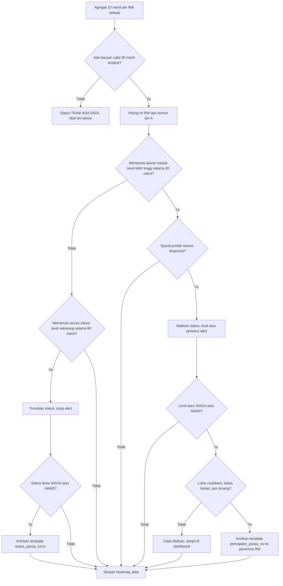

## 14. User Roles and User Journey

Ada lima peran. RT/RW dan kader **berinteraksi utama lewat WhatsApp**, sedangkan kelurahan, admin, dan tim teknis memakai dashboard.

### 14.1 Tabel hak akses

Keterangan: L = lihat, K = kelola (tambah/ubah/hapus), W = hanya wilayahnya, - = tidak ada akses.

| Fitur | Administrator | Pemerintah kelurahan | RT/RW | Kader posyandu | Tim teknis |
| --- | --- | --- | --- | --- | --- |
| Dashboard utama | L (semua) | L (W) | L (W) | L (W) | L (semua) |
| Peta panas | L | L | L (W) | L (W) | L |
| Detail wilayah | L | L (W) | L (W) | L (W) | L |
| Detail sensor dan kesehatan perangkat | L | L (ringkas) | - | - | L, K catatan |
| Riwayat pengukuran + ekspor | L | L (W) | - | - | L |
| Daftar peringatan | L, tutup manual | L (W), buat alert manual | L (W), konfirmasi tindak lanjut | L (W), konfirmasi tindak lanjut | L |
| Terima WhatsApp | Opsional | Ringkasan | Ya | Ya | Notifikasi teknis |
| Manajemen penerima WA | K | K (W) | - | - | - |
| Manajemen perangkat | K | - | - | - | K |
| Pengaturan ambang | K (dengan catatan persetujuan) | Usul | - | - | L |
| Manajemen pengguna | K | - | - | - | - |
| Laporan dan statistik | L | L (W), unduh | - | - | L (data teknis) |

### 14.2 User journey

**Administrator (tim pengelola):** login, cek dashboard semua wilayah pagi hari, tinjau sensor offline dan template WA, tambah pengguna baru dari kelurahan, perbarui versi ambang setelah rapat dengan Dinkes, cek tagihan WA bulanan.

**Pemerintah kelurahan:** menerima ringkasan WA saat ada RW SIAGA, membuka dashboard di laptop kantor, melihat RW mana yang terdampak dan berapa warga rentan, menghubungi RW terkait atau puskesmas, mengunduh laporan bulanan untuk musrenbang (misalnya mengusulkan RTH atau atap dingin di RW yang paling sering SIAGA).

**RT/RW:** menerima WA "PERINGATAN PANAS SIAGA, RW 03", mengumumkan lewat grup WA warga atau pengeras suara, mengecek warga lansia yang tinggal sendiri, membalas "1" sebagai konfirmasi, menerima pesan "status turun" sore hari. Opsional membuka tautan detail RW di HP.

**Kader posyandu:** menerima WA yang sama, memprioritaskan kunjungan ke lansia, balita, dan ibu hamil dalam daftar kader, menyampaikan imbauan minum dan berteduh, melapor ke puskesmas jika ada warga bergejala sesuai arahan Dinkes. Kader tidak diminta mendiagnosis.

**Tim teknis:** menerima notifikasi node offline atau baterai lemah, membuka halaman detail sensor, melihat RSSI dan riwayat, datang ke lokasi, membersihkan shield/mengganti baterai, mencatat di maintenance log, dan memverifikasi data kembali normal.

### 14.3 Diagram interaksi pengguna dengan sistem

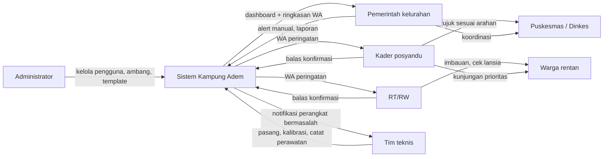

## 15. System Flowcharts

Sepuluh flowchart berikut memakai nama komponen, interval, dan aturan yang sama dengan Bagian 4-14. Flowchart 7 (status peringatan) ada di Bagian 13.5 agar aturannya hanya ditulis di satu tempat.

### 15.1 Flowchart sistem keseluruhan

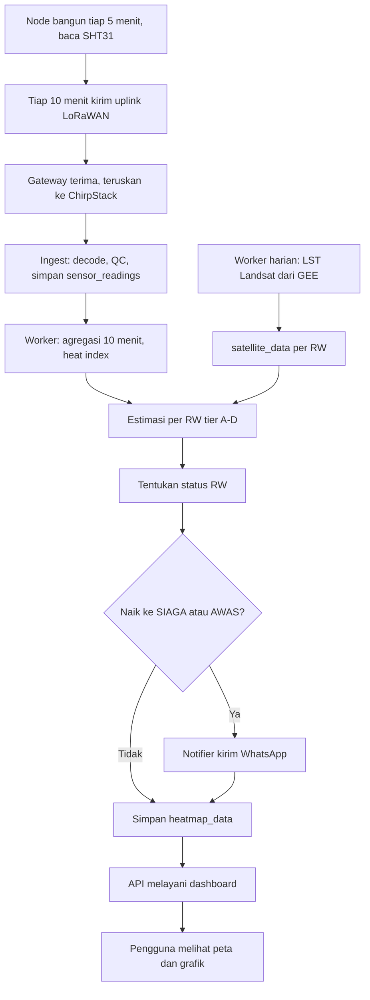

### 15.2 Flowchart pengambilan data sensor (firmware node)

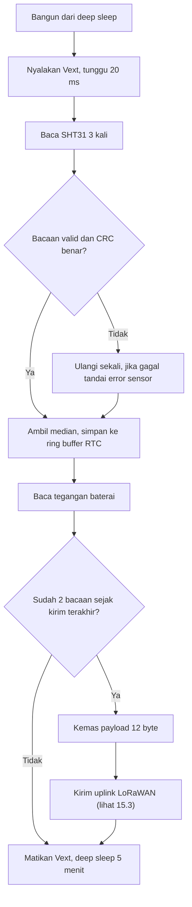

### 15.3 Flowchart komunikasi LoRa

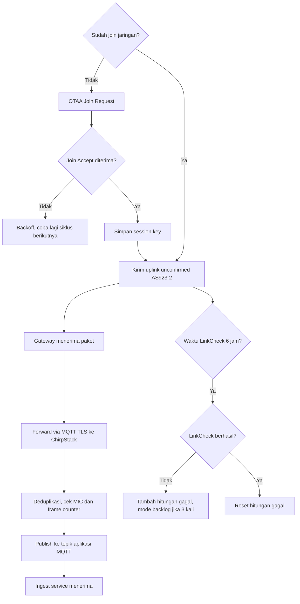

### 15.4 Flowchart pemrosesan data backend

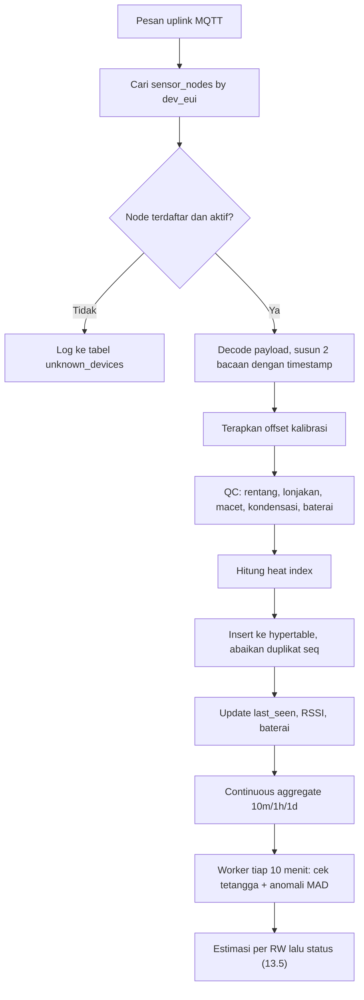

### 15.5 Flowchart integrasi citra satelit

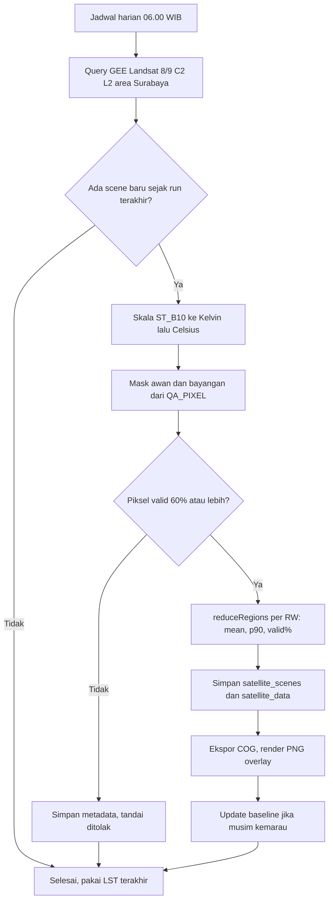

### 15.6 Flowchart pembuatan peta panas

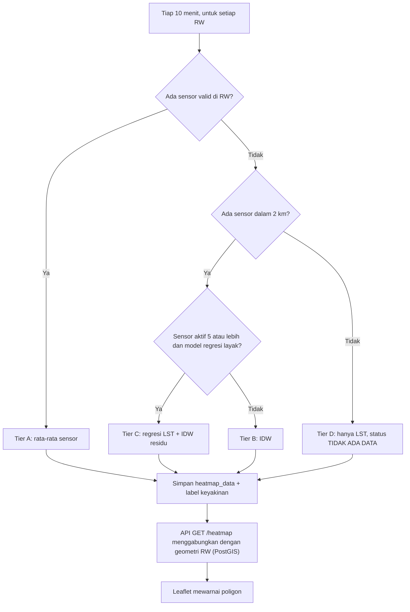

### 15.7 Flowchart penentuan status peringatan

Lihat Bagian 13.5.

### 15.8 Flowchart pengiriman notifikasi WhatsApp

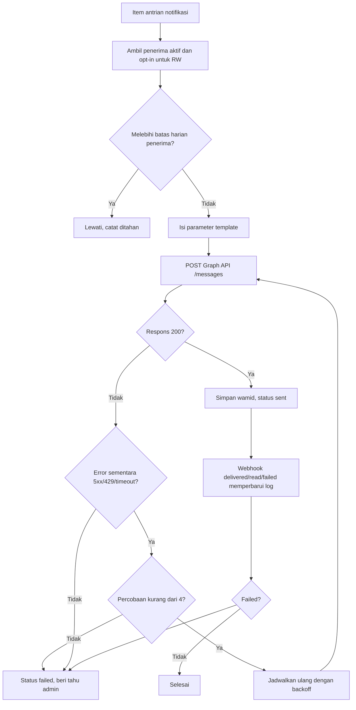

### 15.9 Flowchart interaksi pengguna

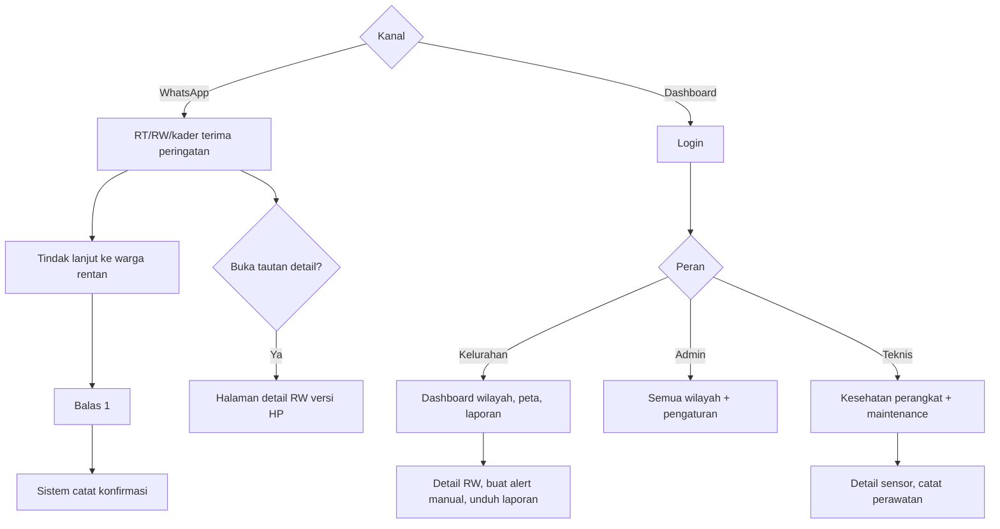

### 15.10 Flowchart penanganan kegagalan perangkat dan komunikasi

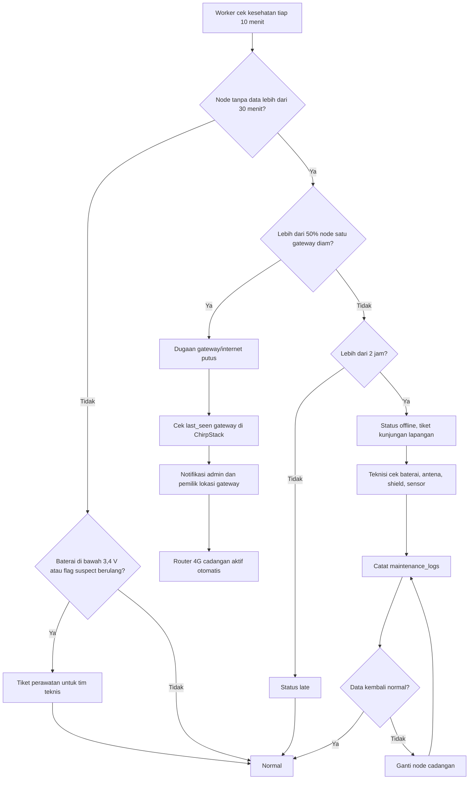

## 16. Infrastructure and Security

Rekomendasi final: **satu VPS di Indonesia (2 vCPU, 4 GB RAM) menjalankan semua container lewat Docker Compose untuk prototype dan pilot**, dipisah menjadi server aplikasi dan server database baru di implementasi awal.

### 16.1 Kebutuhan server

| Tahap | Spesifikasi minimum \[Asumsi\] | Alasan |
| --- | --- | --- |
| Prototype | 2 vCPU, 4 GB RAM, 60 GB SSD | ChirpStack + PostgreSQL + API + worker, data kurang dari 1 GB/tahun |
| Pilot | 4 vCPU, 8 GB RAM, 100 GB SSD | Ruang untuk raster LST, backup lokal, dan uji interpolasi |
| Implementasi awal | App 4 vCPU/8 GB + DB 4 vCPU/8 GB terpisah | Isolasi beban dan backup database lebih aman |

### 16.2 Perbandingan hosting terjangkau

| Penyedia | Paket | Harga/bulan | Catatan |
| --- | --- | --- | --- |
| IDCloudHost | Rocket VPS 1: 2 core, 4 GB, 60 GB | Rp105.000 ([IDCloudHost](https://idcloudhost.com/en/server-vps/)) | Termurah untuk spesifikasi prototype |
| IDCloudHost | Rocket VPS 3: 4 core, 8 GB, 100 GB | Rp215.000 ([IDCloudHost](https://idcloudhost.com/en/server-vps/)) | Cocok untuk pilot |
| IDCloudHost | Intel eXtreme 60 GB: 2 core, 4 GB, NVMe | Rp345.000 ([WHTop](https://www.whtop.com/id/plans/idcloudhost.com/148733)) | Lini cloud dengan NVMe |
| Biznet Gio | NEO Virtual Compute SM 4.2: 2 vCPU, 4 GB, 60 GB | Rp330.000 harga normal ([Biznet Gio](https://biznetgio.com/promo/real-merdeka)) | Jaringan kuat, data center tier-3 lokal |
| Server kampus/Pemkot | Sesuai kebijakan | Rp0 tunai | Pilihan terbaik saat sudah bermitra, butuh izin TI |

Harga belum termasuk PPN 11% bila berlaku. **\[Fakta, dicek 2 November 2026\]**

**Mengapa VPS lokal:** data lokasi rumah penerima dan nomor HP sebaiknya disimpan di Indonesia sesuai semangat UU Pelindungan Data Pribadi (UU No. 27 Tahun 2022). **\[Fakta untuk nama UU; detail kewajiban perlu dikaji\]**

### 16.3 Satu server atau dipisah?

| Opsi | Kelebihan | Kekurangan | Kapan |
| --- | --- | --- | --- |
| Satu server (Docker Compose) | Murah, sederhana, mudah di-backup | Satu titik gagal | Prototype dan pilot |
| App dan DB dipisah | Database aman dari beban app, bisa diskalakan | Biaya 2x, perlu jaringan privat | Implementasi awal |
| Layanan terkelola (managed DB, Kubernetes) | Skalabel | Mahal dan berlebihan untuk skala ini | Tidak direkomendasikan saat ini |

### 16.4 Komponen infrastruktur

| Aspek | Solusi \[Usulan\] |
| --- | --- |
| Domain | `kampungadem.my.id` untuk prototype (sekitar Rp9.000-12.000/tahun; [GoodStats/Domainesia](https://goodstats.id/article/domain-id-di-indonesia-2026-uAhrP), [Bisnis](https://teknologi.bisnis.com/read/20230125/84/1621435/pandi-pengguna-domain-id-terbanyak-di-asia-tenggara)); subdomain resmi Pemkot saat bermitra |
| SSL | Let's Encrypt otomatis via Caddy atau certbot (gratis) |
| Backend deployment | Docker Compose, image dibangun di GitHub Actions, deploy lewat SSH, migrasi Alembic |
| Database deployment | Container `timescale/timescaledb-ha` dengan volume persisten |
| Backup | `pg_dump` harian terenkripsi ke penyimpanan off-site (object storage atau Google Drive tim), retensi 30 hari harian + 12 bulanan; uji restore tiap bulan |
| Monitoring | Uptime Kuma (cek API, ChirpStack, gateway last\_seen), alarm ke Telegram/email tim |
| Logging | Log JSON terstruktur, rotasi 14 hari; audit log untuk perubahan ambang, penerima, dan pengguna |

### 16.5 Keamanan

| Area | Kontrol \[Usulan\] |
| --- | --- |
| Authentication | Password hash Argon2, JWT akses 15 menit + refresh token httpOnly, OTP via WA untuk admin |
| Authorization | RBAC lima peran + `user_scopes` per wilayah, dicek di setiap query |
| Enkripsi komunikasi | HTTPS (TLS) untuk dashboard dan API; MQTT over TLS antara gateway dan ChirpStack; LoRaWAN AES-128 dari node ke network server |
| Keamanan API | Validasi Pydantic, rate limit per IP/token (Redis), CORS terbatas, API key terpisah untuk integrasi ingest, verifikasi signature `X-Hub-Signature-256` pada webhook Meta |
| Rahasia | Token WA, kunci enkripsi, password DB di file `.env` di server (bukan di repo), rotasi tiap 6 bulan |
| Keamanan perangkat IoT | OTAA dengan AppKey unik per node, frame counter check, firmware tanpa Wi-Fi aktif di lapangan, debug port tertutup di dalam kotak, label aset |
| Server | SSH hanya kunci, firewall hanya port 443 dan 8883 (MQTT TLS), update keamanan otomatis, fail2ban |
| Data pengguna | Nomor HP terenkripsi (AES-GCM) + hash, ditampilkan tersamar (0812xxxx890), hanya admin/kelurahan wilayahnya yang bisa melihat; opt-in tercatat; hak hapus data bila penerima berhenti |
| Data warga rentan | Hanya **jumlah** per RW yang disimpan, bukan nama atau alamat warga |

## 17. Budget Estimation

Biaya tunai bulanan diperkirakan **Rp320 ribu (prototype), Rp752 ribu (pilot), dan Rp2,35 juta (implementasi awal)**; jika cadangan penggantian perangkat dan internet cadangan dihitung, menjadi Rp569 ribu, Rp1,36 juta, dan Rp3,88 juta. Biaya terbesar yang tumbuh seiring skala adalah WhatsApp dan perawatan lapangan.

### 17.1 Biaya pengembangan awal (sekali)

| Item | Biaya | Keterangan |
| --- | --- | --- |
| Domain `.my.id` tahun pertama | sekitar Rp9.000-12.000 | [GoodStats](https://goodstats.id/article/domain-id-di-indonesia-2026-uAhrP) |
| Hosting bulan pertama | Rp105.000 | IDCloudHost Rocket VPS 1 |
| Database | Rp0 | Self-host di VPS yang sama |
| Pengembangan backend | Rp0 tunai (in-kind tim) | sekitar 8 orang-minggu **\[Asumsi\]** |
| Pengembangan frontend | Rp0 tunai (in-kind tim) | sekitar 6 orang-minggu **\[Asumsi\]** |
| Firmware node | Rp0 tunai (in-kind tim) | sekitar 4 orang-minggu **\[Asumsi\]** |
| Integrasi WhatsApp | Rp0 platform | Setup Meta gratis; 1-2 orang-minggu |
| Integrasi data satelit | Rp0 | GEE gratis untuk riset; sekitar 3 orang-minggu |
| Pengujian dan dokumentasi | Rp0 tunai | sekitar 3 orang-minggu |

Total upaya sekitar 25 orang-minggu, realistis untuk sub-tim 6-8 mahasiswa IF/STI/Elektro selama 1 semester. **\[Asumsi\]**

### 17.2 Biaya operasional bulanan

| Komponen | Prototype | Pilot | Implementasi awal | Dasar perhitungan |
| --- | --- | --- | --- | --- |
| Server | 105.000 | 215.000 | 430.000 (app + DB) | [IDCloudHost](https://idcloudhost.com/en/server-vps/) |
| Penyimpanan backup off-site | 0 (Drive tim) | 0 | 50.000 | **\[Asumsi\]** |
| Domain (dibagi 12) | 1.000 | 1.000 | 1.000 | `.my.id` |
| WhatsApp API | 53.500 | 214.000 | 1.069.950 | Bagian 11.8, Rp356,65/pesan utility |
| Listrik gateway | 10.800 | 21.600 | 54.000 | Maks 10 W per gateway (5 V/2 A, [spesifikasi LPS8N](https://embeddedworks.net/product/sens666/)), 24 jam x 30 hari, Rp1.500/kWh **\[Asumsi tarif\]** |
| Maintenance (transport, pembersihan, baterai) | 150.000 | 300.000 | 750.000 | **\[Asumsi\]** |
| **Subtotal tunai minimum** | **320.300** | **751.600** | **2.354.950** |  |
| Internet gateway 4G cadangan | 100.000 | 200.000 | 500.000 | Rp100 ribu per gateway **\[Asumsi\]**; Rp0 jika memakai internet mitra |
| Penggantian perangkat | 149.105 | 405.419 | 1.027.499 | 1% nilai hardware per bulan **\[Asumsi\]** |
| **Total dengan cadangan** | **569.405** | **1.357.019** | **3.882.449** |  |

### 17.3 Klasifikasi layanan

| Kategori | Layanan |
| --- | --- |
| Gratis (open source / data terbuka) | FastAPI, React, Leaflet, PostgreSQL, PostGIS, ChirpStack, Let's Encrypt, Uptime Kuma, data Landsat dan MODIS |
| Gratis dengan free tier / syarat | Google Earth Engine (gratis untuk riset, pendidikan, nonprofit), WhatsApp 1.000 pesan service/bulan per nomor, tile OpenStreetMap (kebijakan pemakaian wajar), GitHub Actions, TTN Community (batas 30 detik airtime/hari) |
| Berbayar | VPS, domain, pesan template WhatsApp, kuota 4G, listrik |
| Naik biayanya saat skala bertambah | WhatsApp (linear terhadap penerima x kejadian), VPS dan backup, penyedia tile peta bila trafik melewati pemakaian wajar OSM, lisensi GEE bila dipakai untuk operasional non-riset **\[perlu dicek\]**, perawatan lapangan |

### 17.4 Ringkasan tiga skenario anggaran

| Skenario | Investasi hardware (Bagian 6) | Operasional per bulan (tunai minimum) | Operasional 12 bulan | Total tahun pertama |
| --- | --- | --- | --- | --- |
| 1. Prototype mahasiswa (5 node) | Rp16.401.523 | Rp320.300 | Rp3.843.600 | **Rp20.245.123** |
| 2. Pilot beberapa RW (20 node) | Rp46.623.185 | Rp751.600 | Rp9.019.200 | **Rp55.642.385** |
| 3. Implementasi awal beberapa kecamatan (50 node) | Rp118.162.385 | Rp2.354.950 | Rp28.259.400 | **Rp146.421.785** |

Semua angka adalah estimasi per 2 November 2026 dengan asumsi yang ditandai; harga marketplace, tarif WhatsApp, dan kurs dapat berubah.

## 18. Final Technology Stack

Semua pilihan di bawah saling kompatibel: frekuensi node dan gateway sama (AS923-2), gateway didukung ChirpStack, ChirpStack mengirim MQTT yang dibaca FastAPI, dan PostGIS menghasilkan GeoJSON yang langsung dibaca Leaflet.

| Layer | Teknologi/Produk | Fungsi | Alasan Pemilihan | Alternatif |
| --- | --- | --- | --- | --- |
| Sensor | Sensirion SHT31 (modul GY-SHT31-D) di radiation shield DIY | Suhu udara dan RH | ±0,2 °C/±2 %RH, murah, I2C | SHT35/SHT45 (lebih akurat), probe SHT31 tahan cuaca |
| Microcontroller | Heltec WiFi LoRa 32 V3 (ESP32-S3) | Baca sensor, kelola daya, kirim data | MCU + LoRa + charger dalam satu papan, tersedia di Tokopedia | RAK WisBlock RAK4631 (lebih hemat daya) |
| Komunikasi | LoRaWAN Class A, AS923-2 (920-923 MHz), OTAA | Node ke gateway | Pita LPWA Indonesia, AES-128, banyak node per gateway | LoRa P2P (hanya uji awal) |
| Gateway | Dragino LPS8N AS923 + antena outdoor + 4G cadangan | Menerima paket, meneruskan ke server | Termurah yang ditemukan (Rp4,75 juta), didukung ChirpStack | RAK7268V2, gateway outdoor IP67 |
| Network server | ChirpStack v4 (self-hosted) | Join, dekripsi, deduplikasi, ADR | Gratis, tanpa batas fair use TTN, data di server sendiri | TTN Community |
| Backend | Python 3.12, FastAPI, SQLAlchemy, Pydantic, APScheduler | API, ingest, worker | Satu bahasa untuk IoT, statistik, raster, interpolasi | Django, NestJS |
| Frontend | React + Vite + TypeScript, TanStack Query, Tailwind | Dashboard | Statis, ringan, tim sudah familiar | Next.js (jika butuh halaman publik SSR), Vue |
| Database | PostgreSQL + TimescaleDB + Redis | Relasional, time-series, cache | Satu mesin untuk semua jenis data | InfluxDB + PostgreSQL (tidak dipilih) |
| Geospatial | PostGIS, GeoJSON, Leaflet, tile OSM | Batas wilayah, query spasial, peta | Gratis, standar terbuka | Mapbox GL |
| Satellite Processing | Google Earth Engine Python API, Landsat 8/9 C2 L2 ST, MODIS MOD11A1 | LST per RW, baseline | Tanpa perlu unduh dan olah raster besar sendiri | BIG Piksel, USGS EarthExplorer + rasterio |
| WhatsApp | WhatsApp Cloud API (Meta), template utility | Peringatan ke RT/RW dan kader | Resmi, tanpa biaya platform | BSP resmi (Qontak, Wati, Gupshup) |
| Hosting | VPS Indonesia (IDCloudHost Rocket VPS), Docker Compose, Let's Encrypt, Uptime Kuma | Menjalankan seluruh backend | Rp105 ribu/bulan, data di Indonesia | Biznet Gio, server Pemkot/kampus |

## 19. Implementation Roadmap

Roadmap usulan berjalan sekitar 14 bulan: desain selesai Desember 2026, prototype dan integrasi Januari-Juni 2027, pilot Juli-November 2027 agar mencakup puncak panas musim kemarau-peralihan, lalu implementasi awal mulai Desember 2027 bila mitra pemerintah siap. **\[Usulan; tanggal menyesuaikan jadwal akademik dan pendanaan\]**

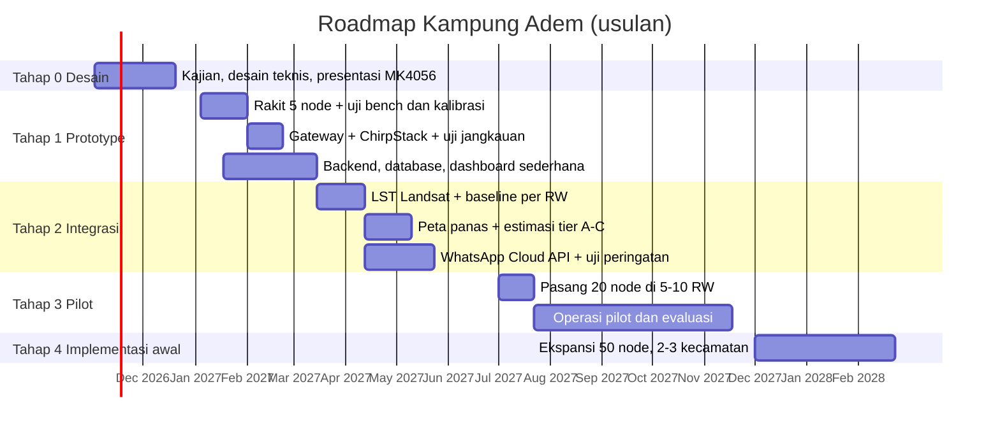

| Tahap | Deliverables | Kebutuhan perangkat | Pekerjaan teknis | Indikator keberhasilan \[Usulan\] |
| --- | --- | --- | --- | --- |
| **0. Desain** (Nov-Des 2026) | Dokumen ini, laporan dan presentasi Proyek Minor, daftar 2-3 kecamatan dari analisis LST tim dampak | Laptop, akun GEE | Analisis LST multi-tahun, survei awal lokasi, kontak awal kelurahan | Dokumen disetujui dosen/asisten; minimal 1 kelurahan bersedia menjadi lokasi pilot |
| **1. Prototype** (Jan-Mar 2027) | 5 node berfungsi, 1 gateway, ChirpStack, database, dashboard tabel + grafik | 5 node, 1 LPS8N, termohigrometer referensi, VPS | Firmware sleep/kirim, decoder payload, ingest, QC, heat index, kalibrasi berdampingan 48 jam | Paket diterima 90% atau lebih selama 14 hari; selisih node vs referensi rata-rata di bawah 0,5 °C setelah offset; node bertahan 14 hari tanpa dicas manual |
| **2. Integrasi** (Mar-Jun 2027) | Peta panas per RW, lapisan LST, WhatsApp dengan template disetujui, pengaturan ambang | Sama, ditambah nomor WA khusus | Pipeline GEE, zonal statistics, tier B/C, notifier + webhook, uji peringatan simulasi | Template utility disetujui Meta; WA terkirim dalam 5 menit setelah status SIAGA pada uji simulasi; peta memuat dalam 3 detik |
| **3. Pilot** (Jul-Nov 2027) | 20 node di 5-10 RW, 2 gateway, 60 penerima, laporan evaluasi pilot | 20 node, 2 gateway, modem 4G | Survei RSSI, pemasangan bersama RT/RW, SOP tindak lanjut bersama Dinkes/puskesmas, pemantauan harian | Uptime data 90% atau lebih per node; 80% atau lebih penerima mengonfirmasi tindak lanjut; tidak lebih dari 3 alert per penerima per hari; masukan Dinkes atas ambang tercatat |
| **4. Implementasi awal** (mulai Des 2027) | 50 node, 5 gateway, MoU dengan Pemkot, server terpisah, laporan bulanan rutin | 50 node, 5 gateway outdoor/box IP66 | Pemisahan app/DB, penguatan keamanan, pelatihan admin kelurahan, sertifikasi perangkat | Dashboard dipakai kelurahan dalam rapat rutin; data dipakai untuk usulan intervensi (RTH, atap dingin) di minimal 1 RW |

## 20. Risiko, Keterbatasan, dan Mitigasi

Risiko terbesar bukan teknis, melainkan **kepercayaan pengguna** (alert terlalu sering atau salah) dan **keberlanjutan** (siapa yang merawat setelah proyek mahasiswa selesai).

| # | Risiko | Dampak | Kemungkinan | Mitigasi |
| --- | --- | --- | --- | --- |
| 1 | Alert terlalu sering sehingga diabaikan | Tinggi | Tinggi | WA mulai level SIAGA, histeresis, cooldown 3 jam, batas 3 pesan/hari, evaluasi ambang tiap bulan bersama Dinkes |
| 2 | Bacaan bias karena shield buruk atau lokasi dekat dinding/AC | Tinggi | Sedang | Shield bertingkat, kalibrasi berdampingan, aturan lokasi pemasangan, flag tetangga dan MAD |
| 3 | Sistem dianggap "cuma aplikasi" (risiko yang disebut di dokumen judul) | Sedang | Sedang | Kaitkan output dengan SOP kader/puskesmas dan bahan perencanaan RTH kelurahan; tampilkan bukti dampak di laporan |
| 4 | Pencurian/vandalisme node | Sedang | Sedang | Titik di pekarangan pengurus RT/RW, baut khusus, label aset, cadangan 15% |
| 5 | Gateway atau internet mitra mati | Tinggi | Sedang | Router 4G cadangan, UPS mini, notifikasi otomatis, backlog di node |
| 6 | Batas RW tidak tersedia resmi | Sedang | Tinggi | Digitasi bersama kelurahan; sementara pakai poligon Voronoi di sekitar sensor dalam batas kelurahan, ditandai "perkiraan" |
| 7 | Template WA ditolak atau direklasifikasi sebagai marketing | Sedang | Sedang | Isi template murni informatif; anggaran cadangan tarif marketing; BSP sebagai jalur bantuan |
| 8 | Verifikasi bisnis Meta sulit tanpa badan hukum | Sedang | Sedang | Daftarkan atas nama mitra (kelurahan/Pemkot) atau ITB; mulai dari nomor tes dan batas awal |
| 9 | Regulasi frekuensi dan sertifikasi SDPPI | Tinggi untuk skala pemerintah | Sedang | Pakai AS923-2 dalam 920-923 MHz, daya sesuai batas; prioritaskan perangkat bersertifikat saat implementasi; konsultasi Balmon setempat |
| 10 | Citra satelit tertutup awan berbulan-bulan | Rendah | Tinggi (musim hujan) | Baseline multi-tahun, MODIS sebagai konteks, sistem tetap berjalan dari sensor |
| 11 | Klaim medis berlebihan | Tinggi | Rendah | Teks template "bukan diagnosis", SOP dari Dinkes, istilah "panas ekstrem tingkat lingkungan" bukan "heatwave" |
| 12 | Kebocoran data nomor HP | Tinggi | Rendah | Enkripsi, RBAC, audit log, server di Indonesia |
| 13 | Tim mahasiswa lulus, sistem tidak terawat | Tinggi | Tinggi | Dokumentasi, serah terima ke kelurahan/Dinkes/himpunan, SOP perawatan sederhana, biaya bulanan kecil |
| 14 | Harga komponen berubah atau stok habis | Rendah | Sedang | Daftar alternatif di Bagian 5, beli bertahap, toleransi anggaran 15% |

**Keterbatasan yang perlu disampaikan jujur kepada dosen dan mitra:**

- Sensor mengukur suhu udara di satu titik, bukan suhu rata-rata seluruh RW.
- Heat index NOAA belum divalidasi untuk populasi dan iklim Surabaya.
- LST satelit tidak real-time dan bukan suhu udara.
- Harga beberapa komponen kecil (antena, charger, shield, bracket) masih asumsi karena listing Indonesia yang terverifikasi belum ditemukan.
- Ambang AWAS 46 °C dan semua angka anti-spam adalah usulan awal yang harus diuji di pilot.

## 21. Kesimpulan dan Rekomendasi

Kampung Adem layak dibangun oleh tim mahasiswa: semua komponen tersedia di Indonesia, total tahun pertama prototype sekitar **Rp20,2 juta**, dan arsitekturnya (LoRaWAN, PostgreSQL/PostGIS, WhatsApp Cloud API) memakai standar terbuka yang bisa diserahkan ke pemerintah.

**Jawaban ringkas pertanyaan tujuan akhir:**

| Pertanyaan | Jawaban |
| --- | --- |
| Perangkat apa yang dibeli? | Per node: Heltec V3, SHT31, 18650, panel 3 W, CN3065, box ABS, shield, bracket. Per kelurahan: gateway Dragino LPS8N + antena + 4G cadangan |
| Bagaimana dipasang? | Tinggi 2-2,5 m, menjauh dari dinding, di pekarangan pengurus RT/RW, 2-5 node per RW, setelah kalibrasi berdampingan 48 jam |
| Bagaimana data dikirim? | LoRaWAN AS923-2 tiap 10 menit ke gateway, lalu internet ke ChirpStack di VPS |
| Bagaimana software dibangun? | FastAPI (API, ingest, worker), React + Leaflet, Docker Compose di VPS Indonesia |
| Bagaimana database menyimpan? | PostgreSQL + TimescaleDB (bacaan) + PostGIS (wilayah), 18 tabel inti |
| Bagaimana peta panas dibuat? | Rata-rata sensor per RW, interpolasi IDW/regresi LST untuk RW tanpa sensor, LST Landsat sebagai lapisan latar |
| Bagaimana WhatsApp terhubung? | WhatsApp Cloud API resmi, System User token, template utility, antrian + webhook status |
| Bagaimana pengguna berinteraksi? | RT/RW dan kader lewat WA (balas "1"), kelurahan/admin/teknis lewat dashboard |
| Siapa yang bertanggung jawab? | Tim mahasiswa (prototype), kelurahan + Dinkes (pilot), Pemkot/Diskominfo (implementasi) |
| Berapa total biaya? | Hardware Rp16,4 juta / Rp46,6 juta / Rp118,2 juta; operasional Rp320 ribu / Rp752 ribu / Rp2,35 juta per bulan |

**Langkah konkret berikutnya:**

| Langkah | Pelaksana | Target |
| --- | --- | --- |
| Finalisasi 2-3 kecamatan terpanas dari LST multi-tahun | Tim Dampak (Geodesi) | Sebelum presentasi |
| Kontak kelurahan calon pilot dan puskesmas | Tim Kelayakan/ketua kelompok | Sebelum presentasi |
| Beli 1 Heltec V3 + 1 SHT31 untuk uji bench dan uji pelindung radiasi | Tim Hardware (Elektro/Telkom) | Desember 2026 |
| Siapkan repo, skema database, dan endpoint ingest | Tim Software (IF/STI) | Desember 2026 |
| Konsultasi ambang dan SOP tindak lanjut | Tim Farmasi Klinik + Dinkes | Sebelum pilot |
| Konsultasi data pembanding dan prakiraan | Tim + BMKG Juanda | Sebelum pilot |

### Sumber

Harga dan halaman dicek 2 November 2026 lewat pencarian web; listing marketplace dapat berubah sewaktu-waktu.

**Konteks proyek:** dokumen Project "Kumpulan Judul Voting" dan "MK4056 PPT Teknis Proyek Minor".

**Hardware dan harga:**

- [Heltec WiFi LoRa 32 V3, Tokopedia raihanastore](https://www.tokopedia.com/raihanastore/heltec-meshtastic-wifi-sx1262-esp32-lora-0-96-inch-blue-oled-display-wifi-lora-32-v3-development-board-for-arduino-with-shell)
- [Heltec WiFi LoRa 32 V3, Tokopedia tokoberkahhh33](https://www.tokopedia.com/tokoberkahhh33/heltec-wifi-lora-32-v3-with-shell-with-sx1262-and-esp32-s3fn8-chip-oled-meshtastic-mesh-network-paxcounter-support-heltec-v3-1730992940889310421)
- [Spesifikasi Heltec V3, Rokland](https://store.rokland.com/collections/heltec-products/products/heltec-wifi-lora-32v3) dan [RigPix](https://rigpix.com/rfboards/heltec_wifilora32v3hf.htm)
- [Pinout Heltec V3, ESPHome](https://devices.esphome.io/devices/heltec-wifi-lora-32-v3/)
- [SHT31-D, Tokopedia isee](https://www.tokopedia.com/isee/sht31-d-temperature-humidity-sensor-breakout-weather-for-arduino-i2c-p) dan [akhishop](https://www.tokopedia.com/akhishop/sht31-d-temperature-humidity-sensor-module)
- [SHT31 outdoor, Tokopedia alfaelectro](https://www.tokopedia.com/alfaelectro/sht31-outdoor-temperature-humidity-sensor-40-125-i2c)
- [Sensirion SHT3x, Mouser](https://www.mouser.pl/sensirion-sht3x-dis-sensors) dan [SHT31, The Pi Hut](https://thepihut.com/collections/new-products-maker/products/fermion-sht31-digital-temperature-humidity-sensor)
- [Dragino LPS8N, Tokopedia rosesana](https://www.tokopedia.com/rosesana/dragino-lps8n-indoor-lorawan-gateway-us915-as923) dan [spesifikasi LPS8N, EmbeddedWorks](https://embeddedworks.net/product/sens666/)
- [RAK7268, Tokopedia cosmic-iot](https://www.tokopedia.com/cosmic-iot/gateway-lora-lorawan-merk-rak-tipe-rak7268-wisgate-edge-lite-2) dan [datasheet RAK7268V2](https://docs.rakwireless.com/product-categories/wisgate/rak7268v2/datasheet)
- [Molicel 18650, Tokopedia](https://www.tokopedia.com/find/molicel-18650)
- [Panel surya 3 W 6 V, Ichibot](https://store.ichibot.id/product/3w-6v-500ma-solar-panel-with-wire-145x145-mm/)
- [CN3065, Sigmanortec](https://sigmanortec.ro/en/mppt-solar-battery-charging-module-37v-cn3065)
- [Junction box Durabox, Tokopedia](https://www.tokopedia.com/find/junction-box) dan [Durabox IP66](https://www.tokopedia.com/indolistrik-tng/abs-junction-box-plastik-190x290x140mm-abu-abu-base-plate-durabox)
- [Radiation shield, Observator](https://www.nauticexpo.com/prod/skyview-systems/product-63248-473723.html) dan [studi shield, University of Malta](https://www.um.edu.mt/library/oar/handle/123456789/89169)

**Jaringan dan regulasi:**

- [Permenkominfo No. 2 Tahun 2023](https://peraturan.go.id/files/permenkominfo-no-2-tahun-2023.pdf) dan [status di BPK](https://peraturan.bpk.go.id/Home/Details/255564/permenkominfo-no-2)
- [Draft lampiran RPM Izin Kelas 2018, Kominfo](https://web.kominfo.go.id/sites/default/files/users/3997/LAMPIRAN%20II%20RPM%20IZIN%20KELAS-KP%202018%20%5B24092018%5D.pdf)
- [LoRaWAN Regional Parameters RP2-1.0.1, LoRa Alliance](https://lora-alliance.org/?p=5981)
- [Pemetaan sinyal LoRa 920-923 MHz, UGM](https://etd.repository.ugm.ac.id/home/detail_pencarian_downloadfiles/505364)
- [TTN Fair Use Policy](https://www.thethingsnetwork.org/forum/t/the-things-network-fair-use-policy/47689)
- [ChirpStack, konfigurasi Dragino](https://chirpstack.io/docs/gateway-configuration/dragino.html)

**Satelit:**

- [Landsat 8-9 L2, Sentinel Hub](https://docs.sentinel-hub.com/api/latest/data/landsat-8-l2/)
- [USGS Landsat Collection 2 Surface Temperature](https://www.usgs.gov/landsat-missions/landsat-collection-2-surface-temperature), [USGS Level-2 Science Products](https://usgs.gov/land-resources/nli/landsat/landsat-collection-2-level-2-science-products), [USGS EROS L2SP](https://www.usgs.gov/centers/eros/science/usgs-eros-archive-landsat-archives-landsat-8-9-olitirs-collection-2-level-2)
- [MODIS MOD11A1, Google Earth Engine Catalog](https://developers.google.com/earth-engine/datasets/catalog/MODIS_MOD11A1)
- [Produk Surface Temperature, BIG Piksel](https://piksel.big.go.id/en/docs/data_products/baseline_satellite/surface_temperature/)

**WhatsApp:**

- [WhatsApp Cloud API Get Started, Meta](https://developers.facebook.com/documentation/business-messaging/whatsapp/get-started)
- [WhatsApp Business Platform Pricing, Meta](https://developers.facebook.com/documentation/business-messaging/whatsapp/pricing)
- [Rate card IDR Jan 2026, Gupshup](https://www.gupshup.ai/resources/wp-content/uploads/2025/12/IDR_Jan2026.pdf)
- [Harga WhatsApp API 2026, Wati](https://www.wati.io/id/blog/gcr-seo-harga-whatsapp-business-api-2026-cara-kerja-kategori-dan-simulasi-biaya-lengkap/) dan [perubahan 1 Oktober 2026, Wati](https://www.wati.io/id/blog/gcr-seo-perubahan-harga-whatsapp-business-1-oktober-2026-panduan-lengkap-tarif-baru-meta/)
- [Perbandingan BSP Indonesia, Go4whatsup](https://www.go4whatsup.com/indonesia/whatsapp-business-api-pricing/)

**Panas dan kesehatan:**

- [Tabel kategori heat index NOAA, NIH PMC](https://pmc.ncbi.nlm.nih.gov/articles/PMC3001853/table/T0001)
- [Analisis BMKG: bukan gelombang panas, Kontan](https://nasional.kontan.co.id/news/bukan-karena-gelombang-panas-ini-analisis-bmkg-soal-fenomena-udara-panas-di-ri)
- [Siaran pers BMKG 2023 (indeks UV)](https://stamet-syamsudinnoor.bmkg.go.id/tulisan/20230427010204.pdf)
- [Heat index Indonesia, NU Online](https://www.nu.or.id/nasional/bukan-gelombang-panas-ini-durasi-dan-penyebab-suhu-panas-di-indonesia-5IvTg)

**Hosting dan domain:**

- [IDCloudHost VPS](https://idcloudhost.com/en/server-vps/), [IDCloudHost eXtreme via WHTop](https://www.whtop.com/id/plans/idcloudhost.com/148733), [Biznet Gio](https://biznetgio.com/promo/real-merdeka)
- [Domain .id 2026, GoodStats](https://goodstats.id/article/domain-id-di-indonesia-2026-uAhrP), [Harga my.id dan .id, Bisnis](https://teknologi.bisnis.com/read/20230125/84/1621435/pandi-pengguna-domain-id-terbanyak-di-asia-tenggara)
